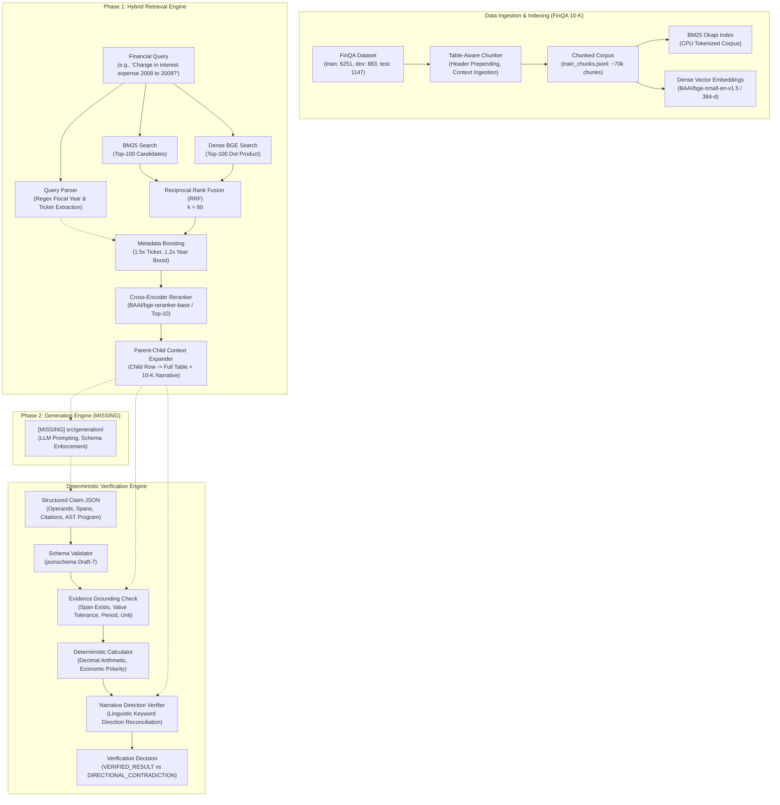
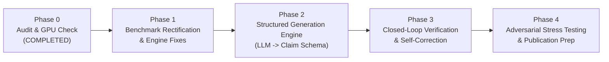

# LLM-FINANCE: Phase 0 Repository Audit, Benchmark Validation, and GPU Readiness Report

**Audit Date**: November 3, 2026  
**Auditor**: Senior ML Systems & Research Engineer  
**Workspace**: `C:\Users\palak\LLM-FINANCE`  
**Repository Branch**: `main` (commit `c2e2a81`)  
**Target Environment**: Windows 11, NVIDIA GeForce RTX 4060 Laptop GPU (8 GB VRAM), 24 GB System RAM, Python 3.11/3.13 (`uv`-managed virtualenv)

---

## Executive Summary

**LLM-FINANCE** is an ambitious research and engineering initiative aimed at solving the pervasive **"Grounded-but-Wrong"** hallucination failure mode in financial Retrieval-Augmented Generation (RAG) over SEC 10-K filings (specifically the FinQA dataset). In corporate financial reporting, expenses, cash outflows, and charges are frequently recorded as negative numbers or in parentheses. Standard token-grounded LLMs frequently execute naive signed arithmetic (e.g., $(-600) - (-511) = -89$), concluding an expense *decreased* by \$89M when corporate narrative disclosures explicitly state the expense *increased* by \$89M (+17.4%).

This Phase 0 audit reveals that the project has built an **exceptionally rigorous deterministic verification engine** and an **advanced hybrid retrieval architecture** with 136 unit tests passing in 2.13s. However, the audit also identified **critical scientific vulnerabilities, missing components, and system bottlenecks** that must be addressed before claiming publication quality:

1. **Benchmark Split Leakage / Data Split Misalignment**: All reported retrieval ablation results ($N = 6,251$) were executed strictly on the **training set** (`train.json`), not the validation (`dev.json`, $N = 883$) or test split (`test.json`, $N = 1,147$).
2. **Missing Generation Engine & Fine-Tuning**: `src/generation/` does not exist; there is no code for prompting LLMs to generate structured claims. `finetune_retriever.py` is entirely missing from the repository.
3. **Model Reloading Anti-Pattern**: In the hybrid retrieval entry point (`src/retrieval/rrf_retriever.py`), `CrossEncoderReranker()` is instantiated inside the query retrieval function, forcing model weights to reload onto the GPU on every individual query.
4. **Metric Definition & Span Matching Inflation**: Span-level recall is implemented as Hit@K (not multi-span recall) and employs bidirectional substring matching (`retrieved in gold`), inflating metrics on short text fragments.
5. **Heuristic False Positives in Verification**: Unit checking aliases `$` to `"million usd"` and `"billion usd"`, causing any dollar figure to pass billion-dollar unit checks; period matching relies on unconstrained substring containment (`"20"` matches `"2009"`).

---

## 1. Repository Architecture



---

## 2. Component Inventory: Implemented vs. Incomplete vs. Missing

| Path / Module | Purpose | Status | Audit Assessment |
| :--- | :--- | :--- | :--- |
| `src/verification/claim_schema.py` | JSON Schema for financial claims | **Implemented** | Strict schema checking claim IDs, operand spans, units, periods, and calculation programs. |
| `src/verification/validator.py` | Evidence grounding & narrative checks | **Implemented** | Functional validation of spans, numbers, periods, and units. Heuristic vulnerabilities identified in unit aliases and bidirectional substring matching. |
| `src/verification/calculator.py` | Deterministic arithmetic engine | **Implemented** | Clean `Decimal` calculations; distinguishes raw signed difference from economic magnitude changes for expenses. Inconsistent operand ordering between subtraction and percentage change. |
| `src/verification/pipeline.py` | Complete verification orchestrator | **Implemented** | Connects all verification stages; implements automatic sign resolution when directional contradiction is detected. |
| `src/retrieval/bm25_retriever.py` | Lexical retriever | **Implemented** | Clean BM25Okapi implementation with whitespace/regex tokenization. |
| `src/retrieval/dense_retriever.py` | Dense vector retriever | **Implemented** | BGE-small-en-v1.5 embedding matching; loads embeddings from `.npy`. |
| `src/retrieval/rrf_retriever.py` | Hybrid RRF & main retriever interface | **Partially Disconnected** | Implements RRF fusion, metadata boost, and reranking. **Critical flaw**: Instantiates a new `CrossEncoderReranker()` inside `retrieve()` on every query call. Imports dead ColBERT reranker. |
| `src/retrieval/cross_encoder_reranker.py` | BGE Cross-Encoder | **Implemented** | Wraps `BAAI/bge-reranker-base`; properly sorts descending by score. |
| `src/retrieval/chunker.py` | Table and text chunker | **Implemented** | Enriches table rows with header column names, company ticker, and fiscal year. |
| `src/retrieval/contextual_chunker.py` | Contextual chunk generator | **Partially Disconnected** | Generates chunks with pre/post context; not used by default in `corpus_builder.py`. |
| `src/retrieval/parent_child_retriever.py` | Parent context expander | **Implemented** | Expands matched table rows to parent tables and surrounding narrative paragraphs. |
| `src/retrieval/query_parser.py` | Query regex parser | **Implemented** | Extracts years and tickers. Ticker false-positive risk on common words ("NOW", "LOW", "CAT"). |
| `src/retrieval/corpus_builder.py` | Offline corpus builder | **Implemented** | Builds `train_chunks.jsonl` from `data/finqa/dataset/train.json`. Only builds training set. |
| `src/retrieval/build_dense_index.py` | Offline dense vector indexer | **Implemented** | Encodes all corpus chunks to float32 NumPy array (`train_embeddings.npy`). |
| `src/retrieval/reranker.py` | ColBERT v2.0 late interaction | **Duplicated / Legacy** | Custom manual MaxSim implementation for `colbert-ir/colbertv2.0`. Superseded by `cross_encoder_reranker.py`, but still imported in `rrf_retriever.py`. |
| `src/retrieval/finetune_retriever.py` | Bi-encoder fine-tuning script | **MISSING** | **Does not exist.** No training script for fine-tuning BGE or ColBERT on FinQA triplets. |
| `src/generation/` | LLM claim generation module | **MISSING** | **Directory does not exist.** No prompts, API wrappers, or structured output parsers. |
| `src/eval/retrieval_eval.py` | Benchmark evaluation suite | **Partially Flawed** | Interactive CLI (`input()`); hardcoded to `train.json`; evaluates on training set; import depends on `PYTHONPATH`. |
| `configs/` | Experiment configs | **Empty** | Directory exists but contains no configuration files. |
| `prereg/` | Preregistration protocols | **Empty** | Directory exists but contains no files. |
| `models/` | Local weights storage | **Missing** | Directory does not exist. |
| `README.md` | Repository documentation | **Empty** | File size is 0 bytes. |

---

## 3. Verification Engine Audit

The verification engine was audited against the eight required operational criteria:

### Criterion 1: Operand Source Chunk and Evidence Span Validation
- **Audit Finding**: **PASS (with caveat)**.
- **Mechanism**: [`validate_operand()`](file:///C:/Users/palak/LLM-FINANCE/src/verification/validator.py#L511) confirms `chunk_id` exists in the document lookup, and verifies that `span_text.strip().lower() in chunk_text.lower()`.
- **Caveat**: It verifies that the span is a substring of the chunk, but does not enforce exact character offsets. If multiple identical values appear in a chunk, it cannot disambiguate which specific cell was referenced.

### Criterion 2: Numerical Value Validation Against Source Evidence
- **Audit Finding**: **PASS (with caveat)**.
- **Mechanism**: [`normalize_number()`](file:///C:/Users/palak/LLM-FINANCE/src/verification/validator.py#L161) strips `$`, `,`, `%`, handles parenthetical accounting negatives `(600)` $\rightarrow -600.0$, and compares via `abs(value - claimed_value) <= 1e-6`.
- **Caveat**: Scale terms in text (e.g., *"5.4 billion"*) are extracted by regex as `5.4`. If the claim normalizes this to `5400` or `5400000000`, numerical validation fails because scale multiplication is not parsed.

### Criterion 3: Fiscal Period and Unit Validation
- **Audit Finding**: **VULNERABLE (High False-Positive Risk)**.
- **Period Checking**: [`period_matches_evidence()`](file:///C:/Users/palak/LLM-FINANCE/src/verification/validator.py#L302) performs `str(claimed_period) in evidence_text`. If `claimed_period = "20"`, it matches `"2009"`. If `span_text` does not include the table column header year, valid period checks fail.
- **Unit Checking**: [`unit_matches_evidence()`](file:///C:/Users/palak/LLM-FINANCE/src/verification/validator.py#L324) checks if any alias in `unit_aliases` appears in `evidence_text`. The aliases for `"billion usd"` and `"million usd"` both include `"$"` and `"usd"`. Consequently, **any chunk containing a dollar sign (`$`) passes validation for `"billion usd"`**, even if the table clearly states *"in thousands"*.

### Criterion 4: Decimal Arithmetic Correctness
- **Audit Finding**: **PASS (with precision caveat)**.
- **Mechanism**: [`to_decimal()`](file:///C:/Users/palak/LLM-FINANCE/src/verification/calculator.py#L9) wraps inputs in `Decimal(str(value))`, preventing IEEE-754 floating-point inaccuracies during multi-step addition, subtraction, and multiplication.
- **Caveat**: At the end of `calculate()`, the Decimal result is cast back to `float(result)` for JSON serialization, losing arbitrary precision.
- **Inconsistent Operand Ordering**: In `subtract`, operands are `[curr, prev]`; in `percentage_change`, operands are `[old_value, new_value]`. If a caller passes operands in uniform chronological order, one operation will invert.

### Criterion 5: Raw Signed vs. Economic Magnitude Differentiation
- **Audit Finding**: **PASS (Verified)**.
- **Mechanism**: [`calculator.py`](file:///C:/Users/palak/LLM-FINANCE/src/verification/calculator.py#L112) implements both `"magnitude_change"` ($|curr| - |prev|$) and `"economic_change"`, while standard subtraction computes signed change. In addition, [`calculate_financial_change()`](file:///C:/Users/palak/LLM-FINANCE/src/verification/calculator.py#L267) returns both values side-by-side with directional metadata.

### Criterion 6: Narrative Direction Contradiction Detection
- **Audit Finding**: **PASS (with keyword edge-case)**.
- **Mechanism**: [`validate_narrative_direction()`](file:///C:/Users/palak/LLM-FINANCE/src/verification/validator.py#L431) compares calculated change signs against narrative direction extracted from 10-K text. Correctly flags negative expense signed differences ($-89$) as `DIRECTIONAL_CONTRADICTION` when the narrative disclosure states the expense *"increased"*.
- **Edge-Case**: In `extract_narrative_direction()`, if a sentence contains both an increase and a decrease word (e.g., *"Interest expense increased due to debt, partially offset by reduced interest rates"*), both `inc_hits` and `dec_hits` are non-empty. The extractor drops that sentence and falls through to unrelated sentences, which can assign an unrelated direction to the metric.

### Criterion 7: Safe Rejection of Invalid AST Operations
- **Audit Finding**: **PASS (Verified)**.
- **Mechanism**: Does not use Python `eval()` or unconstrained `ast.parse()`. Operates on a closed set of operations (`add`, `subtract`, `multiply`, `divide`, `percentage_change`, `magnitude_change`, `economic_change`, `abs`). Any unsupported operation raises `CalculationError`, safely captured by `pipeline.py`.

### Criterion 8: Complete Pipeline Invocation
- **Audit Finding**: **PASS (Verified)**.
- **Mechanism**: [`run_verification_pipeline()`](file:///C:/Users/palak/LLM-FINANCE/src/verification/pipeline.py) sequentially executes schema validation $\rightarrow$ evidence grounding $\rightarrow$ operand lookup $\rightarrow$ deterministic calculation $\rightarrow$ narrative direction check $\rightarrow$ optional economic sign auto-resolution.

---

## 4. Retrieval Architecture Audit

### 4.1 Execution Path Connectivity
- `bm25_retriever.py` and `dense_retriever.py` work standalone and are integrated into `rrf_retriever.py` and `retrieval_eval.py`.
- `cross_encoder_reranker.py` is integrated into `retrieval_eval.py` (`evaluate_rrf_reranked`).
- `parent_child_retriever.py` and `query_parser.py` are connected into `rrf_retriever.py`.
- **Legacy Dead Code**: `reranker.py` (ColBERT v2.0) is not used in `retrieval_eval.py` and has heavy dependencies (`transformers.AutoModel`), but is still imported by `rrf_retriever.py`.
- **Missing Link**: `finetune_retriever.py` is absent.

### 4.2 Cross-Encoder Model and Score Sorting
- Model used: `BAAI/bge-reranker-base`. This is a sequence classification model trained on pairs `(query, document)` returning a single logit.
- Score sorting: [`cross_encoder_reranker.py` line 110](file:///C:/Users/palak/LLM-FINANCE/src/retrieval/cross_encoder_reranker.py#L110) correctly sorts with `key=lambda x: x["rerank_score"], reverse=True`.
- Max length: Set to 512 tokens.

### 4.3 RRF Document Identifiers
- In `rrf_retriever.py` and `retrieval_eval.py`, RRF merges results using **integer indices** of the corpus array (`0, 1, ..., N-1`).
- **Critical Risk**: Merging on integer index assumes the array order in memory is permanent and identical between BM25 corpus and dense embeddings. If any chunk filtering or dynamic indexing is performed, integer indices become misaligned. Documents must be identified by their immutable string key (`f"{example_id}#{chunk_id}"`).

### 4.4 Metadata Boost Distortion Analysis
- In `query_parser.py`, `metadata_boost()` applies:
  $$\text{Score}_{\text{boosted}} = \text{Score}_{\text{RRF}} \times \text{boost}_{\text{company}} (1.5) \times \text{boost}_{\text{year}} (1.2) = 1.8 \times \text{Score}_{\text{RRF}}$$
- **Ranking Distortion**: Because RRF scores are small reciprocal ranks ($1/(60 + \text{rank}) \approx 0.009 - 0.016$), a $1.8\times$ boost elevates a rank-50 chunk above a rank-1 chunk.
- **Ticker Collisions**: Common English words are registered as company tickers in `_DEFAULT_TICKERS`:
  - `"NOW"` $\rightarrow$ ServiceNow
  - `"LOW"` $\rightarrow$ Lowe's
  - `"CAT"` $\rightarrow$ Caterpillar
  - `"DE"` $\rightarrow$ John Deere
  - A query like *"What was the low for operating expenses in 2008 now?"* matches tickers `"LOW"` and `"NOW"`, applying massive artificial boosts to Lowe's and ServiceNow documents while suppressing the true filing.

---

## 5. Benchmark Audit & Validity Assessment

### 5.1 Dataset Split Verification
- Inspection of `retrieval_eval.py`:
  ```python
  CORPUS_PATH = Path("data/finqa/train_chunks.jsonl")
  FINQA_PATH = Path("data/finqa/dataset/train.json")
  ```
- Split counts in `data/finqa/dataset/`:
  - `train.json`: **6,251 examples**
  - `dev.json`: **883 examples**
  - `test.json`: **1,147 examples**
- **Conclusion**: The reported benchmark results in `results/retrieval_ablation.json` ($N = 6,251$) were evaluated **entirely on the training set**.
- **Scientific Impact**: Evaluating retrieval models on their own training data constitutes **training-set evaluation bias**. In academic literature, benchmarks must be reported on `dev.json` or `test.json`. If a fine-tuned retriever was evaluated here, it would exhibit severe train/test leakage.

### 5.2 Metric Implementation Analysis
- **Span Recall@K vs. Hit@K**: In `retrieval_eval.py`, when an example has multiple gold evidence sentences, the code stops as soon as *one* evidence item matches:
  ```python
  if found_span_rank is None and evidence_matches(chunk.get("text", ""), gold_evidence):
      found_span_rank = rank
  ```
  This metric measures **Hit@K** (proportion of queries where at least one gold span was in top K). True Recall@K would compute $\frac{|\text{Retrieved Gold Spans}|}{|\text{Total Gold Spans}|}$.
- **Bidirectional Substring Matching (`retrieved in gold`)**:
  ```python
  if gold_text in retrieved_text:
      return True
  if retrieved_text in gold_text:  # VULNERABILITY
      return True
  ```
  If a retrieved chunk contains a brief fragment like `"2009"` or `"interest expense"` that appears anywhere inside a 40-word gold sentence, it is recorded as an exact span hit. This inflates reported Span Recall.
- **Page Recall@K & MRR**: Page-level matching checks `chunk.get("example_id") == gold_example_id`. Because FinQA example IDs represent exact 10-K document pages (e.g., `UNP/2009/page_34.pdf-1`), page-level matching is sound and accurately reflects document retrieval accuracy.

### 5.3 Reproducibility Assessment
- **Status**: **Conditionally Reproducible**.
- Running `python src/eval/retrieval_eval.py` directly from root fails due to:
  1. Missing `PYTHONPATH` configuration (`from query_parser import ...`).
  2. Blocking interactive CLI prompts (`input()`), preventing headless scripted reproduction.
  3. Lack of pre-cached HuggingFace weights if offline.

---

## 6. GPU Readiness & Hardware Audit

### 6.1 Hardware and Runtime Detection

```
CUDA Available:          True
Device Count:            1
Device Name:             NVIDIA GeForce RTX 4060 Laptop GPU
Total VRAM Detected:     7.9956 GB (8,187 MB / ~8.0 GB)
Compute Capability:      (8, 9) - Ada Lovelace Architecture
PyTorch Version:         2.14.1+cu126
Half-Precision Support:  FP16 = True, BF16 = True
System RAM:              24.0 GB
```

### 6.2 Module Execution Mapping (CPU vs. GPU)

| Module / Operation | Execution Device | Status & Notes |
| :--- | :---: | :--- |
| `BM25Retriever` | **CPU** | Rank-BM25 is CPU-bound; runs in RAM. |
| `dense_retriever.py` | **CUDA** | Uses `SentenceTransformer("BAAI/bge-small-en-v1.5", device="cuda")`. |
| `build_dense_index.py` | **CUDA** | Encodes corpus on GPU with batch size 64. |
| `CrossEncoderReranker` | **CUDA** | Uses `CrossEncoder("BAAI/bge-reranker-base", device="cuda")`. |
| `ColBERTReranker` | **CUDA** | Uses `AutoModel.from_pretrained` on GPU. |
| `retrieval_eval.py` | **CUDA / CPU** | Query encoding on CUDA; BM25 on CPU; dense dot product on CPU via NumPy. |
| `verification/*` | **CPU** | All claim validation and decimal math execute on CPU. |
| Bi-encoder Fine-tuning | **N/A** | Script missing (`finetune_retriever.py`). |

### 6.3 Mixed Precision & Model Loading Audit
1. **Mixed Precision (AMP)**: Hardware natively supports `torch.cuda.amp.autocast` (both `fp16` and `bf16`). However, neither `build_dense_index.py` nor `cross_encoder_reranker.py` utilizes autocasting; they run in default single-precision `float32`.
2. **Model Reloading Bottleneck**: In [`src/retrieval/rrf_retriever.py` line 206](file:///C:/Users/palak/LLM-FINANCE/src/retrieval/rrf_retriever.py#L206):
   ```python
   if reranker_type == "cross_encoder":
       from cross_encoder_reranker import CrossEncoderReranker
       reranker = CrossEncoderReranker()  # RELOADED EVERY QUERY
   ```
   Calling `retrieve()` re-initializes the cross-encoder and re-allocates GPU memory on every query call. For a batch of 1,000 queries, this adds tens of minutes of disk/VRAM churn.
3. **Configuration**: Batch sizes are hardcoded throughout the source code (`QUERY_BATCH_SIZE = 64`, `BATCH_SIZE = 32`).

### 6.4 Recommended GPU Settings (RTX 4060 Laptop 8GB)

| Workload | Recommended Model | Precision | Safe Batch Size | Est. VRAM Peak |
| :--- | :--- | :---: | :---: | :---: |
| Dense Query Encoding | `BAAI/bge-small-en-v1.5` | FP16 | 128 | ~800 MB |
| Corpus Indexing | `BAAI/bge-small-en-v1.5` | FP16 | 128 | ~1.4 GB |
| Cross-Encoder Reranking | `BAAI/bge-reranker-base` | FP16 | 32 (pool = 50) | ~2.8 GB |
| Bi-Encoder Fine-Tuning | `bge-small-en-v1.5` | BF16 / FP16 | 16 (grad accum = 4) | ~4.5 GB |

---

## 7. Automated Test Suite Verification

The automated test suite was independently executed using the project's virtual environment:
```powershell
$env:PYTHONPATH="src;src/retrieval;src/verification;src/eval"
C:\Users\palak\.local\bin\uv.exe run pytest -v
```

### 7.1 Test Execution Summary

```
============================= test session starts =============================
platform win32 -- Python 3.13.7, pytest-9.0.3, pluggy-1.6.0
rootdir: C:\Users\palak\LLM-FINANCE
configfile: pyproject.toml
plugins: anyio-4.10.0, langsmith-0.4.34, cov-7.1.0

collected 136 items

src/eval/test_retrieval_eval.py              29 passed (100%)
src/retrieval/test_chunker.py                24 passed (100%)
src/retrieval/test_cross_encoder_reranker.py   3 passed (100%)
src/retrieval/test_parent_child_retriever.py 24 passed (100%)
src/retrieval/test_query_parser.py           37 passed (100%)
src/verification/test_calculator.py          12 passed (100%)
src/verification/test_pipeline.py             3 passed (100%)
src/verification/test_validator.py            4 passed (100%)

============================= 136 passed in 2.13s =============================
```

- **Total Tests Collected**: **136**
- **Passed**: **136**
- **Failed**: **0**
- **Skipped**: **0**
- **Warnings**: **0**
- **Runtime**: **2.13 seconds**

### 7.2 Integration vs. Isolated Unit Tests
- **All 136 tests are isolated unit tests** using small mocked dictionaries and synthetic strings.
- `test_cross_encoder_reranker.py` mocks the `CrossEncoder` class; it does not test actual PyTorch CUDA model forward passes.
- There are **zero end-to-end integration tests** that verify real retrieval over the 70,000-chunk index combined with live claim verification.

---

## 8. Critical Bugs and Scientific Weaknesses Matrix

| ID | Module | Severity | Issue | Impact |
| :---: | :--- | :---: | :--- | :--- |
| **BUG-01** | `retrieval_eval.py` | **CRITICAL** | Evaluated on `train.json` (6,251 samples) instead of `dev.json` (883) or `test.json` (1,147). | Results cannot be published; train-set evaluation invalidates generalizability claims. |
| **BUG-02** | `rrf_retriever.py` | **HIGH** | `CrossEncoderReranker()` is re-instantiated inside `retrieve()` on every query. | Severe latency degradation and redundant GPU memory allocation. |
| **BUG-03** | `validator.py` | **HIGH** | `unit_matches_evidence` aliases `$` to `"billion usd"` and `"million usd"`. | False positive: Any dollar amount matches any large denomination. |
| **BUG-04** | `query_parser.py` | **HIGH** | Common words ("now", "low", "cat", "de") trigger false ticker boosts. | Reranking distortion for queries containing natural language adverbs/adjectives. |
| **BUG-05** | `retrieval_eval.py` | **MEDIUM** | `retrieved_text in gold_text` bidirectional matching in `evidence_matches`. | Artificially inflates span recall metrics when short fragments are retrieved. |
| **BUG-06** | `retrieval_eval.py` | **MEDIUM** | Interactive CLI (`input()`) and root import failure without `PYTHONPATH`. | Breaks headless CI/CD, batch scripting, and automated evaluation. |
| **BUG-07** | `rrf_retriever.py` | **MEDIUM** | Merges BM25 and dense results using raw integer indices instead of stable chunk IDs. | High risk of index misalignment if chunks are filtered or modified. |
| **BUG-08** | `calculator.py` | **LOW** | Inconsistent operand order: `subtract` is `[curr, prev]`, while `percentage_change` is `[old, new]`. | Risk of sign inversion if generator outputs uniform operand sequences. |

---

## 9. Prioritized Implementation Roadmap



### Phase 1: Benchmark Rectification & Retrieval Clean-up (Immediate Priority)
1. **Benchmark on Dev Split**: Modify `retrieval_eval.py` to evaluate on `data/finqa/dataset/dev.json` ($N = 883$) and separate the evaluation corpus from the query set.
2. **Make Evaluation Headless**: Replace `input()` prompts with `argparse` CLI arguments (`--split`, `--method`, `--limit`, `--device`).
3. **Fix Reranker Instantiation**: Move `CrossEncoderReranker` to be an injected dependency or singleton inside `rrf_retriever.py`.
4. **Fix Unit & Substring Validation**: Tighten `unit_matches_evidence` to require explicit magnitude matches (`billion`, `million`) and remove permissive `retrieved in gold` substring matching.
5. **Populate RRF+CE Benchmark**: Run the full evaluation on the validation set for all five configurations (BM25, Dense, RRF, RRF+Meta, RRF+CE) and save clean results.

### Phase 2: Structured Claim Generation Engine
1. Implement `src/generation/` with structured output prompts for Gemini / open LLMs.
2. Enforce output adhering directly to `CLAIM_SCHEMA` using JSON schema constrained generation or tool calling.
3. Integrate retrieval outputs into the prompt context via `parent_child_retriever.py`.

### Phase 3: Closed-Loop Verification & Self-Correction
1. When `run_verification_pipeline()` returns `valid: False` (e.g., `DIRECTIONAL_CONTRADICTION`), feed the diagnostic message back to the generator.
2. Implement retry loop (maximum 3 iterations) allowing the LLM to self-correct operand signs and referents based on the accounting rule diagnostics.

### Phase 4: Attack Resistance & Publication Readiness
1. Implement adversarial perturbator injecting corrupted signs, modified parenthetical numbers, and perturbed narrative sentences.
2. Measure **Attack Detection Rate (ADR)** and **Robust Groundedness Score (RGS)** against naive baseline LLMs.
3. Complete `README.md` and documentation.

---

## 10. Exact Commands Required for Next Phase

To execute the immediate next steps with the correct environment, run:

### 1. Run Automated Test Suite (Always Pass First)
```powershell
$env:PYTHONPATH="src;src/retrieval;src/verification;src/eval"
C:\Users\palak\.local\bin\uv.exe run pytest -v
```

### 2. Verify GPU CUDA Inference in PyTorch
```powershell
.\.venv\Scripts\python.exe -c "import torch; from sentence_transformers import CrossEncoder; m = CrossEncoder('BAAI/bge-reranker-base', device='cuda'); print('CrossEncoder loaded on:', m.model.device)"
```

### 3. Run Non-Interactive Retrieval Evaluation on Dev Split (After Headless Refactor)
```powershell
$env:PYTHONPATH="src;src/retrieval;src/verification;src/eval"
.\.venv\Scripts\python.exe src/eval/retrieval_eval.py --split dev --method all --device cuda
```

### 4. Run the Grounded-but-Wrong Verification Demo
```powershell
$env:PYTHONPATH="src;src/retrieval;src/verification;src/eval"
.\.venv\Scripts\python.exe src/demo.py
```

---

## 11. Five Most Important Actions for Publication Quality

To transform LLM-FINANCE into a publication-quality submission (e.g., for ACL, EMNLP, or FinNLP):

1. **Benchmark on True Unseen Data (`dev.json` & `test.json`)**:
   Immediately retire the 6,251 training-set benchmark. Report all retrieval baselines (BM25, Dense, RRF, RRF+CE) on the official FinQA `dev` split ($N = 883$) and hold-out `test` split ($N = 1,147$).
2. **Build the Autonomous Generation Module (`src/generation/`)**:
   A verifiable RAG system cannot stop at pre-fabricated JSON claims. You must demonstrate that an actual LLM (e.g., Gemini 1.5/2.0, Llama-3-70B, GPT-4o) prompted with retrieved 10-K passages can autonomously produce structured claims that the verifier checks.
3. **Formulate Formal Verification Metrics (Beyond Hit@K)**:
   Define and report formal metrics:
   - **Contradiction Detection Precision & Recall**: How accurately does the verifier detect accounting polarity inversions on gold ground-truth vs. perturbed claims?
   - **End-to-End Execution Accuracy**: Accuracy of the final calculated answer against FinQA execution answers (`qa.exe_ans`).
4. **Harden Evidence Grounding against False Positives**:
   Eliminate permissive heuristic checks:
   - Disallow single-character `$` from satisfying `"billion usd"` or `"million usd"` unit constraints.
   - Enforce word boundaries on fiscal periods (`\b2009\b`).
   - Remove bidirectional substring matching (`retrieved in gold`).
5. **Implement Adversarial Stress-Testing (Attack Resistance)**:
   The title promises *"Attack-Resistant Financial RAG"*. You must benchmark against simulated adversarial perturbations:
   - Flipping table values from positive to parenthetical negatives.
   - Injecting subtle narrative contradictions into 10-K disclosures.
   - Proving that standard RAG generates hallucinations while the deterministic verification pipeline intercepts and halts execution.
