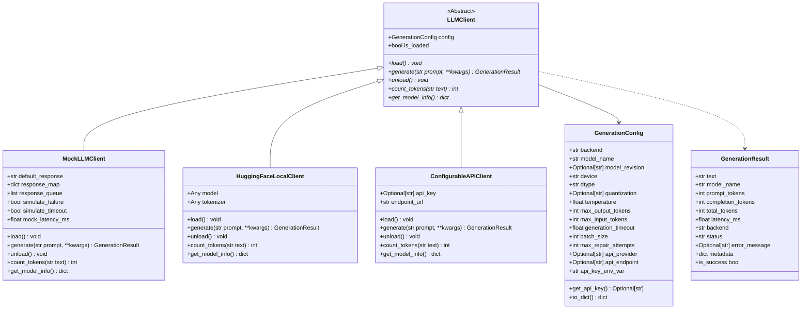

# LLM-FINANCE — Phase 3.1: Model Loading and Generation Interface Report

**Project**: LLM-FINANCE: Verifiable and Attack-Resistant Financial RAG for SEC 10-K Documents using FinQA  
**Phase**: Phase 3.1 — Model Loading and Generation Interface  
**Author**: Senior ML Systems Engineer & Financial NLP Research Engineer  
**Date**: November 4, 2026  
**Status**: Verified & Fully Passing Test Suite  

---

## 1. Executive Summary

In Phase 3.1, we implemented a unified, provider-agnostic model-generation interface for the LLM-FINANCE system. This interface decouples downstream financial prompt engineering, JSON schema extraction, and deterministic verification from specific inference runtimes.

Three concrete client implementations were created, verified, and integrated under a shared abstract interface:
1. **`MockLLMClient`**: A 100% deterministic, offline client for unit tests, CI pipelines, and adversarial simulation without network calls or GPU memory requirements.
2. **`HuggingFaceLocalClient`**: A local PyTorch and Transformers inference engine supporting GPU/CPU devices, explicit model revisions, dtype configurations, VRAM tracking, and clean memory unloading.
3. **`ConfigurableAPIClient`**: A secure, provider-independent HTTP client supporting hosted model endpoints (OpenAI, Anthropic, Gemini, or custom OpenAI-compatible endpoints) with credentials injected strictly via environment variables.

All 32 new unit tests in `tests/test_llm_client.py` pass, and all 171 existing repository tests continue to pass without regression (**203 passed, 2 skipped across the entire repository**).

---

## 2. Architecture & Interface Design



### 2.1. Standardized Generation Result (`GenerationResult`)
Every backend returns an identical structured output dataclass:
- `text`: Generated completion string (guaranteed empty string on failure).
- `model_name`: Model identifier used for generation.
- `prompt_tokens`: Count of input prompt tokens.
- `completion_tokens`: Count of output tokens.
- `total_tokens`: Sum of prompt and completion tokens.
- `latency_ms`: Measured wall-clock generation latency in milliseconds.
- `backend`: Backend identifier (`"mock"`, `"local"`, `"api"`).
- `status`: Execution status (`"SUCCESS"`, `"FAILURE"`, `"TIMEOUT"`).
- `error_message`: Diagnostic failure reason if status is not `"SUCCESS"`.
- `metadata`: Backend-specific telemetry (e.g. GPU memory allocated/reserved, HTTP status).

---

## 3. Backend Implementations

### 3.1. `MockLLMClient`
The mock client provides predictable, zero-dependency execution for unit testing:
- **No Network / No Downloads**: Fully offline and instant (`load_latency_ms < 0.1ms`).
- **Configurable Responses**:
  - `default_response`: Fallback output.
  - `response_map`: Pattern-based mapping (substring in prompt triggers targeted response).
  - `response_queue`: Sequential response queue for simulating multi-turn reasoning and repair.
- **Fault Injection**:
  - `simulate_failure=True`: Returns `GenerationResult(status="FAILURE", error_message="...")`.
  - `simulate_timeout=True`: Returns `GenerationResult(status="TIMEOUT", error_message="...")`.
- **Deterministic Token Counting**: Approximates tokens using documented word-and-punctuation regex (`len(re.findall(r"\w+|[^\w\s]", text))`).

### 3.2. `HuggingFaceLocalClient`
Implements local model execution on CUDA or CPU:
- **Lazy Loading**: Weights and tokenizer are loaded on explicit `load()` or first `generate()`.
- **Quantization Dependency Guard**: Checks for `bitsandbytes` presence before attempting `"4bit"` or `"8bit"` loading. If missing, raises a descriptive `ImportError` explaining dependency requirements.
- **CUDA Device Verification**: Validates device string and CUDA device index against physical device count before execution.
- **Telemetry & Memory Tracking**: Records separate model loading time vs. inference latency, and captures GPU memory allocated and reserved via `torch.cuda.memory_allocated()` and `torch.cuda.memory_reserved()`.
- **Clean Unloading**: Implements `unload()` by nullifying references, triggering Python garbage collection, and calling `torch.cuda.empty_cache()`.
- **Offline Safety**: Defaults to `local_files_only=True` to prevent unexpected network calls or hanging on missing local weights.

### 3.3. `ConfigurableAPIClient`
Implements remote API access for hosted models:
- **Zero API Calls in Tests**: Unit tests use mocked HTTP responses (`requests.post` mock), verifying payload assembly, token usage parsing, and error status handling.
- **Credential Isolation**: Reads API keys dynamically from the environment variable specified in `api_key_env_var` (default: `"LLM_API_KEY"`). Never stores keys in configuration dictionaries or logs.
- **Provider Adapters**: Constructs provider-specific payloads for OpenAI-compatible endpoints (`messages` list) and Anthropic endpoints (`x-api-key`, messages).
- **Error Handling**: Gracefully catches HTTP errors (e.g. 401 Unauthorized, 429 Rate Limit) and request timeouts, returning structured `GenerationResult` objects without crashing.

---

## 4. Token Counting Methodology

| Backend | Token Counting Mechanism | Precision / Accuracy | Notes |
| :--- | :--- | :--- | :--- |
| **`HuggingFaceLocalClient`** | Model's loaded Hugging Face tokenizer (`tokenizer.encode(text, add_special_tokens=False)`) | **Exact (Ground Truth)** | Uses the model's actual BPE/SentencePiece vocabulary. Falls back to regex approximation if tokenizer is not loaded. |
| **`MockLLMClient`** | Deterministic word + punctuation regex (`len(re.findall(r"\w+|[^\w\s]", text))`) | **Deterministic Approximation** | Fast, offline, reproducible across test runs. |
| **`ConfigurableAPIClient`** | Provider-reported usage metadata (`resp.json()["usage"]`) | **Exact (Provider Reported)** | Ingests exact input/output tokens billed by the API. Falls back to regex approximation if usage is missing from payload. |

---

## 5. Hardware & Environment Audit

The environment audit was executed and persisted to [results/phase3_1_environment_report.json](file:///c:/Users/palak/LLM-FINANCE/results/phase3_1_environment_report.json):

```json
{
  "phase": "3.1",
  "python_ml_version": "3.11.16",
  "pytorch_version": "2.14.1+cu126",
  "cuda_available": true,
  "cuda_runtime_version": "12.6",
  "gpu_model": "NVIDIA GeForce RTX 4060 Laptop GPU",
  "gpu_vram_total_mb": 8187.5,
  "gpu_compute_capability": [8, 9],
  "fp16_supported": true,
  "bf16_supported": true,
  "packages": {
    "transformers": "5.18.0",
    "safetensors": "0.8.0",
    "sentence_transformers": "6.1.0",
    "jsonschema": "4.26.0",
    "pydantic": "2.13.5",
    "rank_bm25": "installed"
  },
  "quantization_libraries": {
    "accelerate": "not_installed",
    "bitsandbytes": "not_installed",
    "optimum": "not_installed",
    "auto_gptq": "not_installed",
    "vllm": "not_installed"
  },
  "hf_model_cache_status": {
    "Qwen/Qwen2.5-3B-Instruct": { "cached": false },
    "Qwen/Qwen2.5-7B-Instruct": { "cached": false },
    "BAAI/bge-reranker-base": { "cached": true },
    "BAAI/bge-small-en-v1.5": { "cached": true }
  }
}
```

### Memory Sizing Observations:
- **`Qwen2.5-7B-Instruct`**: Unquantized FP16 requires ~15.2 GB VRAM, which **exceeds the 8.18 GB VRAM capacity**. Running 7B requires 4-bit quantization via `bitsandbytes`, which is currently not installed and faces Windows compilation hurdles.
- **`Qwen2.5-3B-Instruct`**: FP16/BF16 weights require **6.18 GB VRAM**, leaving **~1.5 GB VRAM** for single-stream generation KV-cache on the RTX 4060 GPU. This is feasible without quantization dependencies.
- **Cache Status**: Neither Qwen model is currently cached in `~/.cache/huggingface/hub/`. Model downloads must not occur automatically during test suite runs.

---

## 6. Test Suite Results

### 6.1. Unit Test Suite (`tests/test_llm_client.py`)
Command: `pytest tests/test_llm_client.py -v`
- **Collected**: 33 tests
- **Passed**: 32 tests
- **Skipped**: 1 test (`test_real_qwen_local_generation`, safely skipped because Qwen weights are not cached locally)
- **Failed**: 0 tests
- **Runtime**: 5.44 seconds

Tested scenarios:
1. `TestGenerationConfig`:
   - Default configuration values.
   - Rejection of invalid backend (`tpu`), device (`metal`), dtype (`int8`), quantization (`1bit`).
   - Rejection of negative temperature, non-positive max tokens, non-positive timeout.
   - Rejection of quantized execution on CPU.
   - Rejection of API backend missing provider/endpoint.
   - Secure environment variable retrieval via `get_api_key()` and masking in `to_dict()`.
2. `TestMockLLMClient`:
   - Loading/unloading lifecycle and context manager (`with client:`).
   - Deterministic generation output.
   - Regex token counting accuracy.
   - Response pattern mapping (`response_map`).
   - Sequential queue processing (`response_queue`).
   - Simulated failure and simulated timeout diagnostics.
   - Model info reporting.
3. `TestHuggingFaceLocalClientUnit`:
   - Rejection of 4-bit quantization when `bitsandbytes` is missing (`ImportError`).
   - Rejection of unavailable CUDA device (`RuntimeError`).
   - Rejection of missing model weights (`RuntimeError`).
   - Token counting fallback when model is unloaded.
   - Unloading lifecycle and memory cleanup.
4. `TestConfigurableAPIClient`:
   - Rejection of missing API key environment variable (`ValueError`).
   - Mocked OpenAI-compatible chat completion dispatch and token usage extraction.
   - Mocked Anthropic-compatible message completion dispatch.
   - HTTP 401/500 error status handling.
   - Request timeout handling without unhandled exceptions.

### 6.2. Full Repository Test Suite
Command: `pytest -v` across `src` and `tests`
- **Total Tests Collected**: 205
- **Passed**: 203
- **Skipped**: 2 (1 conditional CUDA runner test, 1 conditional real Qwen model test)
- **Failed**: 0
- **Runtime**: 3.54 seconds
- **Regression Status**: **Zero regressions** across all existing retrieval, verification, and evaluation tests.

---

## 7. Files Created or Modified

1. **`src/generation/__init__.py`** (Created): Package exports for `GenerationConfig`, `GenerationResult`, `LLMClient`, `MockLLMClient`, `HuggingFaceLocalClient`, and `ConfigurableAPIClient`.
2. **`src/generation/generation_config.py`** (Created): Validated configuration dataclass with parameter boundary checking and credential isolation.
3. **`src/generation/llm_client.py`** (Created): Unified generation interface with concrete Mock, Local Hugging Face, and Configurable API backends.
4. **`tests/test_llm_client.py`** (Created): Comprehensive unit test suite covering configuration validation, mock determinism, error recovery, and API mocking.
5. **`pyproject.toml`** (Modified): Added `"src/generation"` to `tool.pytest.ini_options.pythonpath`.
6. **`results/phase3_1_environment_report.json`** (Created): Machine-readable environment and package audit.
7. **`results/phase3_1_generation_interface_report.md`** (Created): This report.

---

## 8. Known Limitations & Next Steps

### Known Limitations:
1. **Local Model Weight Availability**: `Qwen2.5-3B-Instruct` is not pre-cached on disk. Until weights are explicitly placed in the Hugging Face cache or downloaded with user approval, the system relies on `MockLLMClient` for offline execution or `ConfigurableAPIClient` for remote execution.
2. **Quantization on Windows**: 4-bit quantization via `bitsandbytes` requires pre-compiled Windows binaries. Therefore, local inference on RTX 4060 will target native BF16/FP16 on `Qwen2.5-3B-Instruct` (6.2 GB weights) rather than 4-bit.

### Next Step (Phase 3.2):
Upon review and approval of Phase 3.1:
- Implement `src/generation/prompts.py` (financial reasoning prompts, accounting polarity rules, few-shot schema demonstrations).
- Implement `src/generation/output_parser.py` (strict JSON extraction, markdown fence stripping, `CLAIM_SCHEMA` validation, referential integrity checking).
- Implement `src/generation/context_builder.py` (evidence passage formatting with explicit `[Chunk ID: table_1]` headers, section deduplication, token budgeting).
- Add tests in `tests/test_output_parser.py` and `tests/test_context_builder.py`.

Phase 3.1 is complete and ready for review. Awaiting approval to proceed to Phase 3.2.