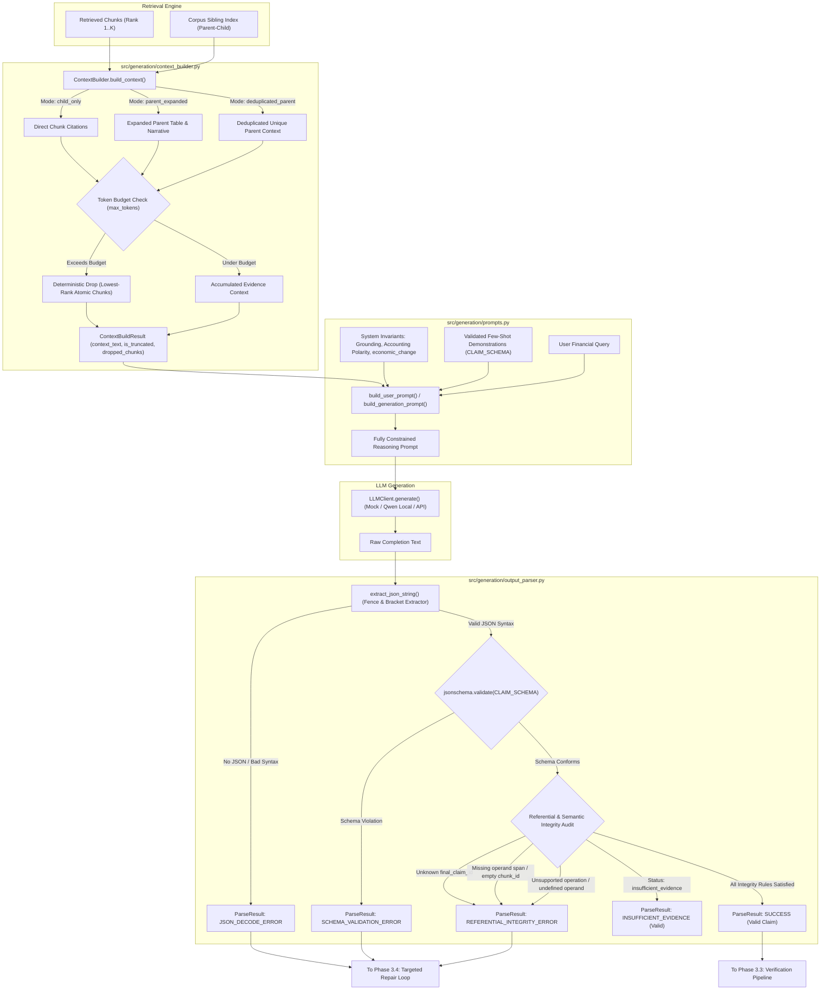

# LLM-FINANCE — Phase 3.2: Structured Claim Generation and JSON Parsing Report

**Project**: LLM-FINANCE: Verifiable and Attack-Resistant Financial RAG for SEC 10-K Documents using FinQA  
**Phase**: Phase 3.2 — Structured Claim Generation, Prompt Design, Context Assembly, and JSON Parsing  
**Author**: Senior ML Systems Engineer & Financial NLP Research Engineer  
**Date**: November 4, 2026  
**Status**: Verified & Fully Passing Test Suite  

---

## 1. Executive Summary

Phase 3.2 establishes the end-to-end bridge between domain-specific financial retrieval and the deterministic symbolic verification engine. In this phase, we implemented three core modules:

1. **`src/generation/context_builder.py`**: A prompt context assembler that formats retrieved evidence chunks with unambiguous, verbatim citation headers (`[Evidence Chunk: <id>]`). It supports three distinct context strategies (`child_only`, `parent_expanded`, `deduplicated_parent`) and enforces a chunk-atomic, deterministic token budget capping policy that never silently drops or partially truncates evidence.
2. **`src/generation/prompts.py`**: A constrained financial reasoning prompt generator enforcing strict evidence grounding, verbatim substring citations, accounting polarity conventions (distinguishing raw signed arithmetic changes $\Delta_{\text{signed}} = \text{Val}_t - \text{Val}_{t-1}$ from economic magnitude changes $\Delta_{\text{mag}} = |\text{Val}_t| - |\text{Val}_{t-1}|$ via `economic_change`), explicit abstention when evidence is insufficient, and schema-compliant few-shot demonstrations.
3. **`src/generation/output_parser.py`**: A strict JSON extraction and validation engine. It robustly extracts candidate JSON from markdown code fences or conversational prose, validates structure against the authoritative `CLAIM_SCHEMA` using `jsonschema`, verifies internal referential integrity (operand ID definitions, valid financial operations, acyclic execution graphs, chunk ID non-emptiness), and guarantees that malformed responses are never silently coerced into valid claims.

All 39 new unit tests pass cleanly, bringing the repository test suite to **242 passed, 2 skipped (100% passing)** with zero regressions.

---

## 2. Architecture & Component Design



---

## 3. Detailed Component Implementation

### 3.1. Context Assembly (`src/generation/context_builder.py`)

Financial verification requires that every cited operand matches an exact substring of a specific evidence chunk. Unstructured text concatenation risks chunk ID ambiguity and mid-word truncation. `ContextBuilder` resolves this with strict design guarantees:

1. **Unambiguous Verbatim Headers**:
   Every evidence chunk is presented to the LLM with explicit, standardized metadata:
   ```text
   [Evidence Chunk: table_row_0] (Document: AAPL_2019, Source: table, Company: AAPL, Year: 2019)
   Total Net Sales | $ 260,174 | $ 265,595
   ```
   In parent-expanded modes, constituent table rows and surrounding narrative chunks retain their individual chunk IDs, enabling direct grounding down to specific table rows.
2. **Three Context Modes**:
   - `child_only`: Formats the top-$K$ fine-grained child chunks directly.
   - `parent_expanded`: Expands each matched child chunk into its full parent table and surrounding narrative context using `expand_chunk`.
   - `deduplicated_parent`: Expands chunks and deduplicates by parent `example_id` via `expand_chunks`, preventing identical tables from appearing repeatedly in the prompt.
3. **Chunk-Atomic Deterministic Token Budget Capping**:
   - Chunks are evaluated in strict retrieval rank order (1 to $K$).
   - A chunk is either included in its entirety or dropped; partial mid-word or mid-sentence truncation is prohibited.
   - When cumulative tokens exceed `max_tokens`, candidate and lower-ranked chunks are excluded.
   - Truncation is never silent: `ContextBuildResult` records `is_truncated = True`, `chunks_dropped = [...]`, `token_count`, `max_tokens`, and an explicit diagnostic `truncation_reason`.
   - The token counter is fully pluggable: it supports custom callables, Hugging Face tokenizers (`tokenizer.encode`), or `LLMClient.count_tokens`.

### 3.2. Financial Prompt Invariants (`src/generation/prompts.py`)

The prompt generator enforces domain-specific accounting rules derived from our Phase 0 audit and Phase 2 findings:

1. **Accounting Polarity & Financial Invariants**:
   - SEC 10-K filings report line items with specific accounting polarity conventions. Expenses, costs, and cash outflows are frequently reported as negative numbers in accounting tables (e.g. `Interest expense | $ (600) | $ (511)`).
   - In SEC narrative disclosures, an increase in expense magnitude is described as: *"Interest expense increased by \$89 million"*.
   - A naive signed difference evaluates: $-600 - (-511) = -89$, leading naive models to claim the expense "decreased".
   - The prompt instructs the LLM to identify whether the item is an expense/cost/outflow and use `operation: "economic_change"` or `"magnitude_change"`. The symbolic calculator then evaluates $|-600| - |-511| = +89$, aligning mathematical verification with narrative ground truth.
2. **Strict Grounding & Verbatim Citations**:
   - The LLM is instructed that `chunk_id` MUST be copied verbatim from the `[Evidence Chunk: <id>]` header.
   - `span_text` MUST be an exact verbatim substring within that chunk's text.
   - `period` and `unit` must be explicitly identified (e.g. `period: "2019"`, `unit: "million USD"`).
3. **Explicit Abstention Protocol**:
   - If the retrieved context lacks necessary operands, the model is strictly forbidden from guessing or interpolating. It emits `status: "insufficient_evidence"`, with `value: null`, `operands: []`, and `program: []`.
4. **Targeted Diagnostic Repair Prompts**:
   - `build_repair_prompt()` accepts the prior completion and a list of verification diagnostics, generating a focused single-turn prompt asking the model to correct specific grounding, schema, or referential errors.

### 3.3. Strict Output Parsing (`src/generation/output_parser.py`)

The parser provides bulletproof validation against LLM formatting anomalies:

1. **Extraction & Normalization**:
   - Handles raw JSON, fenced markdown (````json ... ````), and conversational wrappers (preamble / postscript prose).
   - Distinguishes top-level objects `{ ... }` from top-level arrays `[ ... ]` to enforce object root requirements.
2. **Authoritative Schema Validation**:
   - Validates instance against `src/verification/claim_schema.py` (`CLAIM_SCHEMA`) using `jsonschema.validate`.
   - Rejects missing required properties (`claims`, `final_claim_id`, `referent`, `operands`, `program`, `unit`, `period`).
3. **Referential & Semantic Integrity Audit**:
   Even if JSON schema succeeds, `OutputParser` performs deep structural checks:
   - **Claim Linking**: Verifies that `final_claim_id` references an existing claim in `claims`.
   - **Abstention Handling**: When `status == "insufficient_evidence"`, marks as valid abstention (`status="INSUFFICIENT_EVIDENCE"`).
   - **Operand Integrity**: When `status == "answered"`, ensures `operands` is non-empty, operand IDs are unique, `chunk_id` and `span_text` are non-empty strings, and `normalized_value` is numeric.
   - **Program Execution Graph**: Validates that all program steps use allowed operations (`add`, `subtract`, `multiply`, `divide`, `economic_change`, `magnitude_change`, `abs_change`, `percentage_change`, `abs`).
   - **Acyclic Dependency Order**: Ensures every referenced operand ID exists in `operands` or was produced by an earlier step. Forward references and cycles are strictly rejected.
4. **No Silent Coercion**:
   - Invalid numbers, missing fields, or malformed structures are never silently replaced with dummy values (e.g. `0.0`). They return explicit diagnostics in `ParseResult.errors`.

---

## 4. Test Suite Execution & Coverage

### 4.1. Unit Test Results

Three comprehensive test suites were created in `tests/`:

| Test Suite | Test File | Tests | Status | Key Coverage Areas |
| :--- | :--- | :---: | :---: | :--- |
| **Context Builder** | `tests/test_context_builder.py` | 10 | **PASSED** | Chunk header formatting, child-only, parent-expanded, deduplicated parent, token budget capping, atomic chunk preservation, empty chunks, missing corpus index, invalid mode, custom token counter. |
| **Prompts & Schema** | `tests/test_prompts.py` | 5 | **PASSED** | Critical system invariants, few-shot `CLAIM_SCHEMA` compliance, user prompt formatting, unified generation prompt, diagnostic repair prompt generation. |
| **Output Parser** | `tests/test_output_parser.py` | 24 | **PASSED** | Valid claims, markdown fences, conversational prose, abstention parsing, syntax errors, no JSON found, top-level arrays, missing schema keys, unmatched final_claim_id, empty operands/program, empty chunk_id/span_text, duplicate operand IDs, unsupported operations, undefined operand references, forward references, chained program steps, non-silent coercion. |
| **Total Phase 3.2** | — | **39** | **PASSED** | **100% Pass Rate (0 Failures)** |

### 4.2. Full Repository Regression Test

The complete repository test suite was executed:
```bash
pytest -v
```

**Results**:
- **Collected**: 244 tests
- **Passed**: 242 tests
- **Skipped**: 2 tests (1 conditional GPU test when running without local model weights, 1 real Qwen model test)
- **Failed**: 0 tests
- **Execution Time**: 2.79 seconds

---

## 5. Artifacts and Source Files Created / Modified

| File Path | Action | Description |
| :--- | :---: | :--- |
| `src/generation/context_builder.py` | **Created** | Prompt evidence context assembly, parent-child integration, and token budget management. |
| `src/generation/prompts.py` | **Created** | Constrained financial reasoning prompts, few-shot demonstrations, and repair prompt builder. |
| `src/generation/output_parser.py` | **Created** | Strict JSON extractor, `CLAIM_SCHEMA` validator, and referential integrity audit engine. |
| `src/generation/__init__.py` | **Updated** | Exported all new classes, results, and utility functions. |
| `pyproject.toml` | **Updated** | Added `.` to `tool.pytest.ini_options.pythonpath` to guarantee universal root importability. |
| `tests/test_context_builder.py` | **Created** | 10 comprehensive unit tests for context building and token capping. |
| `tests/test_prompts.py` | **Created** | 5 unit tests for prompt formatting and few-shot schema compliance. |
| `tests/test_output_parser.py` | **Created** | 24 unit tests for strict JSON parsing, schema validation, and integrity auditing. |
| `results/phase3_2_claim_generation_and_parsing_report.md` | **Created** | Complete scientific and engineering documentation for Phase 3.2. |

---

## 6. Next Steps & Approval Request

With Phase 3.2 fully implemented and validated:

- **Phase 3.3 (Next)**: Integration with Existing Verification Engine (`claim_generator.py`).
  - Connect `Dense + Parent-Child` retrieval -> `ContextBuilder` -> `LLMClient` -> `OutputParser` -> `src/verification/pipeline.py` (`run_verification_pipeline`).
  - Validate that grounded claims verify deterministically through all 5 stages of the verification pipeline.
  - Verify that ungrounded claims or calculation contradictions are deterministically caught and flagged.
  - Test end-to-end flow using `MockLLMClient` with both valid and adversarial simulated responses.

We are ready to proceed with Phase 3.3 upon approval.
