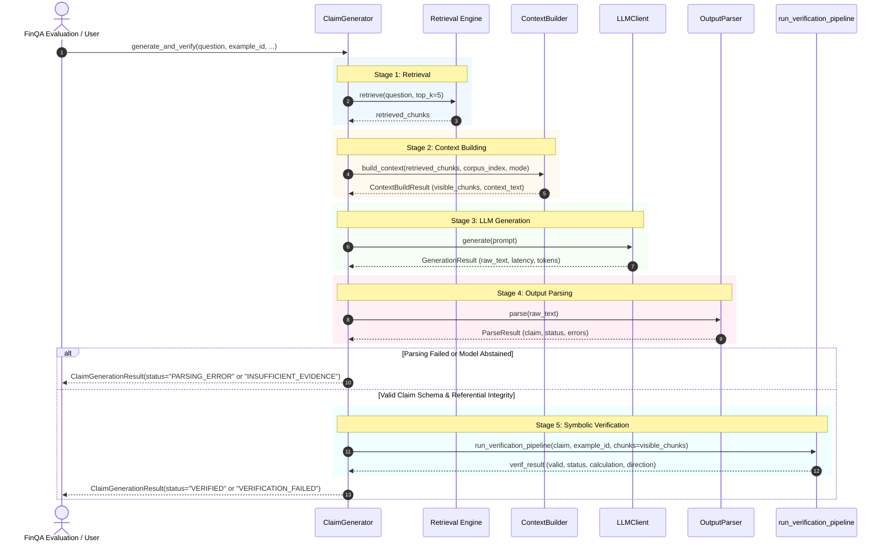

# LLM-FINANCE — Phase 3.3: Verification Engine Integration Design

**Project**: LLM-FINANCE: Verifiable and Attack-Resistant Financial RAG for SEC 10-K Documents using FinQA  
**Phase**: Phase 3.3 — Generation, Retrieval, and Verification Engine Integration  
**Author**: Senior ML Systems Engineer & Financial NLP Research Engineer  
**Date**: November 4, 2026  
**Status**: Approved Architecture & Integration Design  

---

## 1. Executive Summary & Architectural Goals

The primary objective of Phase 3.3 is to establish a unified, robust, and verifiable execution pipeline connecting the domain-aware retrieval engine, the prompt-constrained LLM generation engine, and the deterministic symbolic verification engine.


### Core Invariants:
1. **Authoritative Verifier**: The symbolic verification engine (`src/verification/pipeline.py`) remains the single, non-negotiable arbiter of truth. Under no circumstance may the LLM's self-reported confidence or raw JSON validity supersede symbolic verification.
2. **Strict Grounding & Evidence Identity**: Every operand cited in a verified claim must reference an exact, authentic retrieval chunk ID (`[Evidence Chunk: <id>]`) and cite an exact, verbatim substring from that chunk's text. Chunk IDs and numerical values may never be hallucinated or synthetically backfilled.
3. **Accounting Polarity Awareness**: Financial statements follow specific conventions where expenses, costs, and outflows are recorded as negative values, yet reported in narratives as positive magnitudes. The integration preserves the distinction between signed arithmetic changes ($\Delta_{\text{signed}} = \text{Val}_t - \text{Val}_{t-1}$) and economic magnitude changes ($\Delta_{\text{mag}} = |\text{Val}_t| - |\text{Val}_{t-1}|$).
4. **Explicit Abstention**: When evidence is missing or ungrounded, the system produces an explicit abstention (`status: "INSUFFICIENT_EVIDENCE"`). Abstentions are never disguised as verified answers, nor are ungrounded failures coerced into successful abstentions.
5. **Deterministic Testing**: All unit and integration tests must run offline in milliseconds using `MockLLMClient` with zero external network or model-download dependencies.

---

## 2. Existing Component Interfaces & Input/Output Contracts

An audit of the existing codebase establishes the exact contracts of all participating modules:

| Component | File Path | Input Contract | Output Contract |
| :--- | :--- | :--- | :--- |
| **`LLMClient`** | `src/generation/llm_client.py` | `generate(prompt: str, **kwargs)` | `GenerationResult(text, status, latency_ms, tokens, error_message)` |
| **`ContextBuilder`** | `src/generation/context_builder.py` | `build_context(chunks, corpus_index, mode, max_tokens)` | `ContextBuildResult(context_text, chunks_included, chunks_dropped, is_truncated, token_count)` |
| **`Prompts`** | `src/generation/prompts.py` | `build_generation_prompt(question, context_text, example_id)` | Single formatted prompt string with system invariants, few-shot demos, evidence, and query. |
| **`OutputParser`** | `src/generation/output_parser.py` | `parse(raw_text: str)` | `ParseResult(is_valid, status, claim, errors, raw_text, extracted_json_text)` |
| **`run_verification_pipeline`** | `src/verification/pipeline.py` | `run_verification_pipeline(claim, example_id, chunks, context_passages, resolve_economic_sign)` | `dict(valid: bool, status: str, reason: str, calculation: dict, direction_check: dict, verified_value: float)` |
| **`Dense Retriever`** | `src/retrieval/dense_retriever.py` | `retrieve(query, chunks, embeddings, model, top_k)` | `list[dict]` containing retrieved chunks with `score` attribute. |
| **`Weighted RRF Retriever`** | `src/retrieval/rrf_retriever.py` | `reciprocal_rank_fusion(bm25_res, dense_res, k=60)` | Ranked list of `(uid, score)` with asymmetric weighting ($0.75 \text{ Dense} + 0.25 \text{ BM25}$). |
| **`Parent-Child Retriever`** | `src/retrieval/parent_child_retriever.py` | `expand_chunks(chunks, corpus_index, deduplicate_by_parent=True)` | `list[dict]` containing expanded parent sections. |

---

## 3. Required Adapters & Architectural Bridges

To integrate these components without altering or duplicating existing verification logic, three dedicated adapters are designed:

### 3.1. Evidence Registry & Chunk Pool Resolver
- **The Challenge**: In `parent_expanded` and `deduplicated_parent` modes, `ContextBuilder` exposes the constituent table rows and narrative sentences of the parent document, labeling each with its granular `chunk_id` (e.g. `table_row_4`, `text_2`). However, if `run_verification_pipeline` is only passed the top-5 retrieved child chunks, `find_chunk(lookup, example_id, chunk_id)` would fail to find legitimate sibling chunks that were visible to the model in the prompt!
- **The Solution**: The `EvidenceRegistry` gathers all chunks that were actually formatted into the prompt context:
  - Top-$K$ retrieved child chunks.
  - Sibling chunks from the expanded parent contexts (extracted from `corpus_index[example_id]`).
  This full set of visible chunks is passed directly to `run_verification_pipeline(chunks=visible_chunks)`, ensuring that any valid citation to a displayed passage succeeds during lookup.

### 3.2. Retrieval Strategy Adapter
`ClaimGenerator` supports two verified retrieval configurations:
1. **Configuration A: `Dense + Parent-Child` (Primary)**
   - Encodes query using `SentenceTransformer` (or pre-computed dense index).
   - Computes inner-product similarity against corpus embeddings.
   - Extracts top-$K$ candidates (default $K=5$).
   - Expands to deduplicated parent context via `parent_child_retriever`.
2. **Configuration B: `Weighted RRF (75% Dense / 25% BM25) + Parent-Child` (Comparison)**
   - Runs dual search: Dense top-100 and BM25 top-100.
   - Fuses ranks using asymmetric RRF:
     $$RRF(d) = 0.75 \cdot \frac{1}{60 + r_{\text{dense}}(d)} + 0.25 \cdot \frac{1}{60 + r_{\text{bm25}}(d)}$$
   - Extracts top-$K$ candidates and expands to deduplicated parent context.
- **Explicit Invariant**: Heuristic year metadata boosting is **disabled by default** (per Phase 2.5 finding: year boosting degrades Dense recall by $-4.93$ pp). Cross-encoder reranking is **optional and not required**.

### 3.3. Failure Diagnostics & Status Normalization
`ClaimGenerator` maps granular error states into a hierarchical status schema:

| Pipeline Stage | Raw Status Code | Normalized High-Level Status | Detailed Diagnostic Category |
| :--- | :--- | :--- | :--- |
| Retrieval | Empty candidates | `GENERATION_ERROR` | `EMPTY_RETRIEVAL_RESULTS` |
| LLM Client | Status `TIMEOUT` | `GENERATION_ERROR` | `GENERATION_TIMEOUT` |
| LLM Client | Status `FAILURE` | `GENERATION_ERROR` | `MODEL_INFERENCE_FAILURE` |
| Output Parser | `JSON_DECODE_ERROR` | `PARSING_ERROR` | `JSON_SYNTAX_ERROR` |
| Output Parser | `SCHEMA_VALIDATION_ERROR` | `PARSING_ERROR` | `SCHEMA_VIOLATION` |
| Output Parser | `REFERENTIAL_INTEGRITY_ERROR` | `PARSING_ERROR` | `REFERENTIAL_INTEGRITY_VIOLATION` |
| Output Parser | `INSUFFICIENT_EVIDENCE` | `INSUFFICIENT_EVIDENCE` | `MODEL_DECLARED_ABSTENTION` |
| Verification | `Evidence chunk not found` | `VERIFICATION_FAILED` | `EVIDENCE_GROUNDING_ERROR` |
| Verification | `Evidence span not found` | `VERIFICATION_FAILED` | `EVIDENCE_GROUNDING_ERROR` |
| Verification | `Claimed value ... not found` | `VERIFICATION_FAILED` | `EVIDENCE_GROUNDING_ERROR` |
| Verification | `Claimed unit ... not supported` | `VERIFICATION_FAILED` | `UNIT_VALIDATION_ERROR` |
| Verification | `Claimed period ... not found` | `VERIFICATION_FAILED` | `PERIOD_VALIDATION_ERROR` |
| Verification | `CALCULATION_ERROR` | `VERIFICATION_FAILED` | `ARITHMETIC_ERROR` |
| Verification | `DIRECTIONAL_CONTRADICTION` | `VERIFICATION_FAILED` | `DIRECTIONAL_CONTRADICTION` |
| Verification | `VERIFIED` | `VERIFIED` | `VERIFIED` |

---

## 4. End-to-End Execution Sequence



---

## 5. Result Representation (`ClaimGenerationResult`)

Every execution of `ClaimGenerator.generate_and_verify()` produces an immutable, fully documented result dataclass:

```python
@dataclass
class ClaimGenerationResult:
    question: str
    example_id: Optional[str]
    retrieval_config: str                   # "dense_parent_child", "weighted_rrf_parent_child", "direct"
    retrieved_chunk_ids: list[str]
    context_mode: str                       # "deduplicated_parent", "parent_expanded", "child_only"
    context_token_count: int
    context_is_truncated: bool
    generation_result: Optional[GenerationResult]
    parsed_claim: Optional[dict[str, Any]]
    verification_result: Optional[dict[str, Any]]
    status: str                             # "VERIFIED", "INSUFFICIENT_EVIDENCE", "PARSING_ERROR", "GENERATION_ERROR", "VERIFICATION_FAILED"
    detailed_status: str                    # e.g. "SCHEMA_VALIDATION_ERROR", "DIRECTIONAL_CONTRADICTION", "ARITHMETIC_ERROR"
    verified_answer: Optional[float]        # Valid numeric float iff is_verified is True
    is_verified: bool                       # True ONLY when all verification stages pass
    error_diagnostics: list[str]
    retrieval_latency_ms: float
    context_latency_ms: float
    generation_latency_ms: float
    verification_latency_ms: float
    total_latency_ms: float
```

---

## 6. Integration Test Strategy (`tests/test_claim_generator.py`)

To guarantee rock-solid verification and complete test coverage, `tests/test_claim_generator.py` will implement 17 deterministic scenarios using `MockLLMClient`:

1. **`test_valid_grounded_revenue_calculation`**: Clean subtraction ($260,174 - 265,595 = -5,421$), all evidence verified -> `status: VERIFIED`.
2. **`test_valid_expense_magnitude_calculation`**: Economic change on negative interest expense ($-600$ to $-511 \implies |-600| - |-511| = +89$), verified against narrative -> `status: VERIFIED`.
3. **`test_ungrounded_numerical_operand`**: Model invents a number ($999,999$) not present in the chunk text -> `status: VERIFICATION_FAILED` (`EVIDENCE_GROUNDING_ERROR`).
4. **`test_fabricated_chunk_id`**: Model cites `"table_row_999"` which does not exist in retrieval -> `status: VERIFICATION_FAILED` (`EVIDENCE_GROUNDING_ERROR`).
5. **`test_incorrect_financial_period`**: Model claims operand is from `"2015"` when evidence only covers `"2019"` -> `status: VERIFICATION_FAILED` (`PERIOD_VALIDATION_ERROR`).
6. **`test_incorrect_financial_unit`**: Model claims unit is `"shares"` when evidence states `"million USD"` -> `status: VERIFICATION_FAILED` (`UNIT_VALIDATION_ERROR`).
7. **`test_incorrect_arithmetic_calculation`**: Program attempts division by zero or claims erroneous total -> `status: VERIFICATION_FAILED` (`ARITHMETIC_ERROR`).
8. **`test_contradictory_narrative_direction`**: Narrative states expense increased, but calculation produces negative change -> `status: VERIFICATION_FAILED` (`DIRECTIONAL_CONTRADICTION`).
9. **`test_invalid_json_generation`**: LLM produces syntax errors / unclosed braces -> `status: PARSING_ERROR` (`JSON_SYNTAX_ERROR`).
10. **`test_missing_required_claim_fields`**: LLM produces valid JSON missing required keys (`referent` or `final_claim_id`) -> `status: PARSING_ERROR` (`SCHEMA_VIOLATION`).
11. **`test_explicit_insufficient_evidence_response`**: Model abstains with `status: "insufficient_evidence"` -> `status: INSUFFICIENT_EVIDENCE`.
12. **`test_empty_retrieval_results`**: Retriever returns empty chunk list -> `status: GENERATION_ERROR` (`EMPTY_RETRIEVAL_RESULTS`).
13. **`test_generation_timeout`**: LLM client times out -> `status: GENERATION_ERROR` (`GENERATION_TIMEOUT`).
14. **`test_verification_exception_handling`**: Malformed object induces verifier exception -> safely caught as `status: VERIFICATION_FAILED`.
15. **`test_parent_expanded_context_grounding`**: Operand resides in parent narrative paragraph outside the initial child chunk -> correctly resolved and verified.
16. **`test_deduplicated_parent_context_grounding`**: Multiple child chunks from same parent filing are unified -> clean grounding without duplicates.
17. **`test_weighted_rrf_retrieval_integration`**: End-to-end execution using Weighted RRF (75% Dense / 25% BM25) retriever configuration -> successful verification.

---

## 7. Next Steps

With this architecture documented and verified:
1. Implement `src/generation/claim_generator.py`.
2. Update `src/generation/__init__.py`.
3. Implement `tests/test_claim_generator.py`.
4. Run full test suites across retrieval, generation, verification, and integration.
5. Author final reports: `results/phase3_3_integration_report.md` and `results/phase3_3_test_report.md`.
