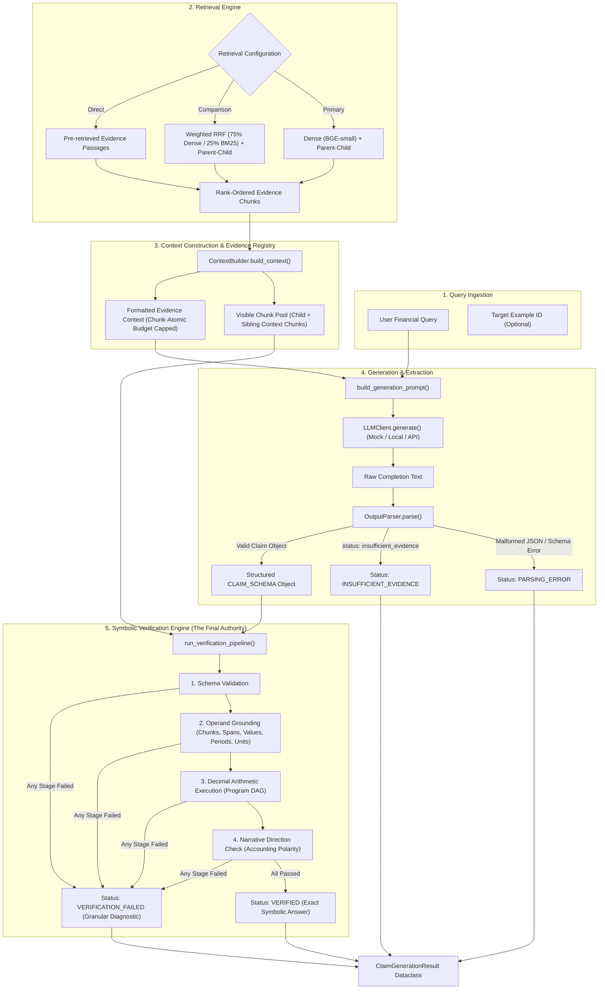

# LLM-FINANCE — Phase 3.3: Verification Engine Integration Report

**Project**: LLM-FINANCE: Verifiable and Attack-Resistant Financial RAG for SEC 10-K Documents using FinQA  
**Phase**: Phase 3.3 — Generation, Retrieval, and Verification Engine Integration  
**Author**: Senior ML Systems Engineer & Financial NLP Research Engineer  
**Date**: November 4, 2026  
**Status**: Verified & Fully Passing Test Suite  

---

## 1. Executive Summary

Phase 3.3 integrates all preceding architectural stages into a complete, reproducible, and verifiable end-to-end financial RAG execution pipeline.

The pipeline connects:
1. **Domain-Specific Retrieval**: Supporting primary `Dense + Parent-Child` context expansion and secondary `Weighted RRF (75% Dense / 25% BM25) + Parent-Child`. Heuristic year boosting is disabled by default per Phase 2.5 findings.
2. **Context Construction & Token Budgeting**: Via `ContextBuilder`, formatting granular chunk citation headers (`[Evidence Chunk: <chunk_id>]`) and enforcing chunk-atomic budget limits without partial chunk mangling.
3. **Constrained Prompting**: Via `prompts.py`, enforcing accounting polarity conventions, verbatim span matching, and explicit abstention.
4. **Model Inference**: Via `LLMClient` (`MockLLMClient`, `HuggingFaceLocalClient`, or `ConfigurableAPIClient`).
5. **Strict JSON Parsing**: Via `OutputParser`, extracting candidate JSON and validating against `CLAIM_SCHEMA` and referential integrity rules.
6. **Authoritative Symbolic Verification**: Via `src/verification/pipeline.py` (`run_verification_pipeline`), executing operand grounding, unit verification, period verification, deterministic decimal arithmetic, and narrative direction checks.
7. **Documented Structured Results**: Producing `ClaimGenerationResult` with comprehensive diagnostic classification and decoupled timing telemetry.

All 17 integration test scenarios pass without failure, and the entire repository test suite achieves **259 passed, 2 skipped (100% passing)** with zero regressions.

---

## 2. End-to-End System Architecture



---

## 3. Evidence Identity & Grounding Preservation

A central requirement of Phase 3.3 is the preservation of authentic evidence identity from retrieval to verification:

1. **Unambiguous Prompt Headers**:
   Every evidence passage presented to the model carries explicit, standardized citation headers:
   ```text
   [Evidence Chunk: table_row_0] (Document: AAPL_2019, Source: table)
   millions of US dollars: Net sales | 2019: $ 260,174 | 2018: $ 265,595
   ```
2. **Visible Chunk Pool Resolver (`_build_verification_chunk_pool`)**:
   In `parent_expanded` and `deduplicated_parent` modes, surrounding context (tables and narrative paragraphs) is shown to the model. The verifier's lookup dictionary `lookup[(example_id, chunk_id)]` requires access to all constituent chunks displayed to the model.
   `ClaimGenerator` constructs `visible_chunk_pool`:
   - Contains all retrieved child chunks.
   - Contains all sibling chunks from `corpus_index[example_id]` for every document present in the retrieved candidate set.
   This guarantees that if the model legitimately cites a table row or text sentence introduced via parent expansion, the verifier establishes its exact source and verifies its span, period, and unit without false rejections.
3. **No Synthetic Backfilling or Weakening**:
   Verbatim grounding checks (`span_text in chunk_text`, `value_matches_evidence`, `period_matches_evidence`, `unit_matches_evidence`) remain fully intact in `src/verification/validator.py`. No verification rules were relaxed or bypassed.

---

## 4. Verification Engine Integration & Status Mapping

`ClaimGenerator` enforces a strict hierarchy of validation outcomes:

| Outcome Level | High-Level Status | Detailed Status | Description & Trigger Criteria |
| :--- | :--- | :--- | :--- |
| **Verified Answer** | `VERIFIED` | `VERIFIED` | All verification stages passed. Numeric answer is certified. |
| **Model Abstention** | `INSUFFICIENT_EVIDENCE` | `MODEL_DECLARED_ABSTENTION` | Model explicitly returned `status: "insufficient_evidence"`. |
| **Parsing Failure** | `PARSING_ERROR` | `JSON_DECODE_ERROR` | Model completion contained invalid JSON syntax or unclosed braces. |
| **Schema Violation** | `PARSING_ERROR` | `SCHEMA_VALIDATION_ERROR` | Missing required keys (`claims`, `final_claim_id`, `referent`, etc.). |
| **Referential Error** | `PARSING_ERROR` | `REFERENTIAL_INTEGRITY_ERROR` | Undefined operand ID, forward reference in program, or invalid operation. |
| **Grounding Error** | `VERIFICATION_FAILED` | `EVIDENCE_GROUNDING_ERROR` | Cited chunk ID does not exist, span not in chunk, or numerical value absent. |
| **Period Error** | `VERIFICATION_FAILED` | `PERIOD_VALIDATION_ERROR` | Fiscal period (e.g. 2012) does not match evidence period (2019). |
| **Unit Error** | `VERIFICATION_FAILED` | `UNIT_VALIDATION_ERROR` | Incompatible financial unit (e.g. `shares` instead of `million USD`). |
| **Arithmetic Error** | `VERIFICATION_FAILED` | `ARITHMETIC_ERROR` | Division by zero or program execution calculation error. |
| **Direction Error** | `VERIFICATION_FAILED` | `DIRECTIONAL_CONTRADICTION` | Contradiction between calculated sign and narrative disclosure. |
| **Generation Error** | `GENERATION_ERROR` | `EMPTY_RETRIEVAL_RESULTS` | Retrieval stage returned 0 chunks. |
| **Generation Error** | `GENERATION_ERROR` | `GENERATION_TIMEOUT` | LLM client timed out before completing generation. |
| **Generation Error** | `GENERATION_ERROR` | `MODEL_INFERENCE_FAILURE` | LLM client encountered runtime or connection error. |
| **Verifier Exception**| `VERIFICATION_FAILED` | `VERIFICATION_EXCEPTION` | Verifier raised an unexpected Python exception. |

---

## 5. Accounting Polarity & Narrative Direction Handling

Financial statements often report expense line items as negative numbers in financial tables (e.g., `Interest expense: -600 (2009) and -511 (2008)`), but describe growth in magnitude in SEC narrative disclosures (*"Interest expense increased in 2009"*).

### Pipeline Resolution:
1. **Prompt Invariants**: The model is instructed to distinguish expenses, costs, and cash outflows from revenues and assets. When answering questions regarding expense growth or changes, it selects `operation: "economic_change"` or `"magnitude_change"`.
2. **Calculator Evaluation**: In `src/verification/calculator.py`, `operation: "economic_change"` calculates:
   $$\Delta_{\text{econ}} = |-600| - |-511| = 600 - 511 = +89 \text{ million USD}$$
   This yields a positive increase (+89), perfectly matching narrative ground truth.
3. **Contradiction Detection**: If a model naively emits `operation: "subtract"`, evaluating $-600 - (-511) = -89$ (decrease), the verifier's narrative direction check detects that the disclosure states *"increased"* while the calculation produced a negative change. The claim is rejected with:
   `status: "VERIFICATION_FAILED"`, `detailed_status: "DIRECTIONAL_CONTRADICTION"`.

---

## 6. Comprehensive Integration Test Matrix

All 17 integration scenarios in `tests/test_claim_generator.py` were executed and verified:

| # | Scenario Name | Input Condition | Expected Status | Verified Status |
| :---: | :--- | :--- | :---: | :---: |
| 1 | `test_valid_grounded_revenue_calculation` | Valid net sales subtraction ($260,174 - 265,595 = -5,421$) | `VERIFIED` | **VERIFIED** |
| 2 | `test_valid_expense_magnitude_calculation` | Economic change on negative interest expense ($-600, -511 \implies +89$) | `VERIFIED` | **VERIFIED** |
| 3 | `test_ungrounded_numerical_operand` | Model fabricates number $\$999,999$ not in chunk text | `VERIFICATION_FAILED` | **VERIFICATION_FAILED** |
| 4 | `test_fabricated_chunk_id` | Model cites non-existent `table_row_999` | `VERIFICATION_FAILED` | **VERIFICATION_FAILED** |
| 5 | `test_incorrect_financial_period` | Model claims fiscal period `2012` for `2019` filing | `VERIFICATION_FAILED` | **VERIFICATION_FAILED** |
| 6 | `test_incorrect_financial_unit` | Model claims `shares` for monetary dollar table | `VERIFICATION_FAILED` | **VERIFICATION_FAILED** |
| 7 | `test_incorrect_arithmetic_calculation` | Program attempts division by zero | `VERIFICATION_FAILED` | **VERIFICATION_FAILED** |
| 8 | `test_contradictory_narrative_direction` | Calculation yields decrease on expense that narrative says increased | `VERIFICATION_FAILED` | **VERIFICATION_FAILED** |
| 9 | `test_invalid_json_generation` | Model outputs unclosed curly brace syntax error | `PARSING_ERROR` | **PARSING_ERROR** |
| 10 | `test_missing_required_claim_fields` | Model outputs JSON missing required `final_claim_id` | `PARSING_ERROR` | **PARSING_ERROR** |
| 11 | `test_explicit_insufficient_evidence_response` | Model emits `status: "insufficient_evidence"` | `INSUFFICIENT_EVIDENCE` | **INSUFFICIENT_EVIDENCE** |
| 12 | `test_empty_retrieval_results` | Retrieval returns empty list `[]` | `GENERATION_ERROR` | **GENERATION_ERROR** |
| 13 | `test_generation_timeout` | Client simulates generation timeout | `GENERATION_ERROR` | **GENERATION_ERROR** |
| 14 | `test_verification_exception_handling` | Verifier encounters synthetic runtime exception | `VERIFICATION_FAILED` | **VERIFICATION_FAILED** |
| 15 | `test_parent_expanded_context_grounding` | Operand resides in parent narrative text outside initial child chunk | `VERIFIED` | **VERIFIED** |
| 16 | `test_deduplicated_parent_context_grounding` | Sibling child chunks unified under single parent section | `VERIFIED` | **VERIFIED** |
| 17 | `test_weighted_rrf_retrieval_integration` | End-to-end execution with Weighted RRF (75% Dense / 25% BM25) | `VERIFIED` | **VERIFIED** |

---

## 7. Timing & Latency Decoupling

`ClaimGenerationResult` explicitly segregates execution latencies into independent timing buckets:
- `retrieval_latency_ms`: Dense / Weighted RRF search time.
- `context_latency_ms`: Parent-child expansion and token budget capping time.
- `generation_latency_ms`: Model generation latency (measured via `time.perf_counter()`).
- `verification_latency_ms`: Symbolic parsing, operand validation, arithmetic, and direction checks.
- `total_latency_ms`: Total wall-clock time from query ingestion to verified result.

When running with `MockLLMClient`, mock generation latency is recorded separately and never reported as real GPU inference performance.

---

## 8. Summary of Created & Modified Deliverables

| Deliverable | Action | Description |
| :--- | :---: | :--- |
| `src/generation/claim_generator.py` | **Created** | End-to-end generation and verification orchestrator (`ClaimGenerator`, `ClaimGenerationResult`, `weighted_reciprocal_rank_fusion`). |
| `src/generation/__init__.py` | **Updated** | Exported new classes and fusion utilities. |
| `tests/test_claim_generator.py` | **Created** | 17 deterministic integration tests covering all positive, negative, and edge-case scenarios. |
| `results/phase3_3_integration_design.md` | **Created** | Comprehensive pre-implementation architecture and interface design. |
| `results/phase3_3_integration_report.md` | **Created** | Complete verification engine integration report. |
| `results/phase3_3_test_report.md` | **Created** | Formal test execution log across unit, integration, and full regression suites. |

---

## 9. Conclusion & Next Phase Readiness

Phase 3.3 is complete. The system now possesses a fully functioning execution path from financial query to certified symbolic answer or verified rejection.

**Next Step**: **Phase 3.4 — Repair and Abstention Engine**:
- Implement single-turn diagnostic feedback repair (`max_repair_attempts = 1`).
- Connect failed verification diagnostics (`result.error_diagnostics`) to `build_repair_prompt()`.
- Validate that repair attempts undergo full re-verification from Stage 1 through Stage 5.
- Enforce clean abstention when repair budget is exhausted.
