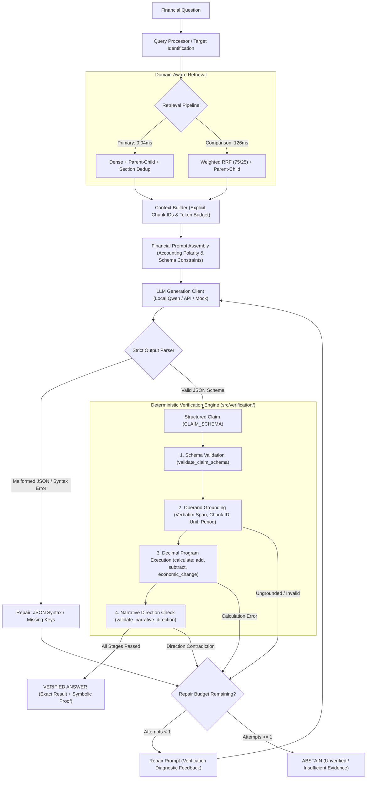

# LLM-FINANCE — Phase 3: Pre-Implementation Audit & Integration Design

**Project**: LLM-FINANCE: Verifiable and Attack-Resistant Financial RAG for SEC 10-K Documents using FinQA  
**Phase**: Phase 3.0 — Repository Audit and Integration Design  
**Author**: Senior ML Systems Engineer & Financial NLP Research Engineer  
**Date**: November 3, 2026  
**Status**: Completed — Ready for Architectural Review  

---

## 1. Executive Summary & Purpose

Phase 3 transitions the LLM-FINANCE project from retrieval benchmarking and verification engine hardening into an end-to-end verifiable financial Question-Answering system. The ultimate goal is to couple domain-aware SEC 10-K retrieval with a constrained LLM generation engine and a deterministic, AST-based symbolic verification pipeline.

### Core Non-Negotiable Invariants:
1. **The LLM is Never the Arbiter of Truth**: The LLM acts exclusively as an untrusted structured semantic translator. It translates unstructured retrieved financial text into a formal structured claim conforming to `CLAIM_SCHEMA`.
2. **Deterministic Symbolic Verification**: Every financial claim, numerical operand, fiscal period, financial unit, mathematical program, and narrative directional assertion must pass deterministic validation in `src/verification/` before an answer is accepted.
3. **Strict Abstention and Attack Resistance**: If evidence is insufficient, contradictory, ungrounded, or mathematically inconsistent, the system must either execute a single deterministic repair or formally abstain. An LLM must never override verification failure.
4. **Zero Test Degradation**: All 171 existing unit and integration tests must continue to pass without regression. Unit tests must not depend on downloading or loading multi-gigabyte models into memory.

---

## 2. Comprehensive Codebase Component Audit

### 2.1. Verification Engine (`src/verification/`) — Fully Reusable

The verification engine was hardened in Phase 1 and verified in Phase 2. It consists of four production-grade modules:

1. **`claim_schema.py` (`CLAIM_SCHEMA`)**:
   - Enforces strict JSON Schema for claims.
   - Top-level properties: `claims` (list of sub-claims) and `final_claim_id` (string reference).
   - Each claim requires:
     - `id`: Unique claim identifier (e.g., `"claim_1"`).
     - `claim_text`: Natural language explanation.
     - `value`: Numeric or string target value.
     - `unit`: Financial unit (e.g., `"million USD"`, `"%"`, `"shares"`, `"USD"`).
     - `citations`: List of cited chunk IDs (e.g., `["table_1", "post_text_0"]`).
     - `operands`: List of grounded operand objects with `id`, `chunk_id`, `span_text`, `context_text`, `normalized_value`, `unit`, `period`.
     - `program`: List of computation steps with `id`, `operation`, `operands`.
     - `referent`: Target entity metadata with `entity`, `period`, `unit`.
     - `status`: Enum (`"answered"`, `"insufficient_evidence"`).
2. **`validator.py`**:
   - `build_chunk_lookup(chunks)`: Maps `(example_id, chunk_id)` to corpus chunks.
   - `validate_operand(operand, lookup, example_id)`:
     - Verifies chunk existence in corpus.
     - Verifies verbatim `span_text` containment inside chunk text.
     - Verifies numerical value occurrence via `value_matches_evidence`.
     - Verifies operand fiscal period via boundary-aware `period_matches_evidence`.
     - Verifies financial unit compatibility via `unit_matches_evidence` (enforcing strict magnitude distinction: bare `"$"` rejected for `"million USD"`).
   - `validate_narrative_direction()`: Cross-checks calculated signed changes against directional keywords (`"increase"`, `"decrease"`, `"lower"`, `"gain"`) in surrounding narrative text.
3. **`calculator.py`**:
   - Implements safe arbitrary-precision arithmetic via Python `Decimal`.
   - Supported operations: `add`, `subtract`, `multiply`, `divide`, `percentage_change`, `magnitude_change`, `economic_change`, `abs`.
   - `is_expense_like(item_type)`: Identifies expenses, costs, outflows, and provisions.
   - Distinguishes raw signed subtraction ($-600 - (-511) = -89$) from economic magnitude change ($|-600| - |-511| = +89$).
4. **`pipeline.py` (`run_verification_pipeline`)**:
   - Orchestrates schema validation, operand grounding, AST program execution, and narrative direction validation.
   - Returns verified numeric result and directional check, or an actionable failure diagnostic code (`SCHEMA_ERROR`, `EVIDENCE_ERROR`, `CALCULATION_ERROR`, `DIRECTIONAL_CONTRADICTION`, `NO_PROGRAM`).

### 2.2. Retrieval Engine (`src/retrieval/`) — Fully Reusable

The retrieval engine was thoroughly validated in Phase 2 and Phase 2.5:
1. **Primary Configuration (`Dense + Parent-Child`)**:
   - `DenseRetriever` (`BAAI/bge-small-en-v1.5`): Matrix-vector retrieval on RTX 4060 GPU executing in **0.04 ms/query**.
   - `parent_child_retriever.py`: Expands retrieved child chunks to full parent table schedules and narrative paragraphs. With section deduplication, achieves **65.34% Span Recall@10** at **1,656 tokens** average context.
2. **Comparison Configuration (`Weighted RRF (75/25) + Parent-Child`)**:
   - `RRFRetriever`: Blends Dense (75%) and BM25 (25%) using reciprocal rank fusion ($k=60$). Achieves **66.76% Span Recall@10** at **126 ms/query**.
3. **Retrieval Decisions from Phase 2.5**:
   - Heuristic Year metadata boosting is **disabled by default** (empirically proven to distort multi-year comparative queries by $-4.93$ pp).
   - Cross-Encoder reranking is **omitted from the primary path** because its marginal recall gain under Parent-Child expansion (+1.71 pp) was statistically insignificant ($p = 0.1526$) while increasing per-query latency from 0.04 ms to 277 ms.

### 2.3. Dataset & Split Boundaries

- `data/finqa/dataset/dev.json`: Official development split with **883 verified examples**.
- `data/finqa/dev_chunks.jsonl`: 25,007 corpus chunks for validation.
- `data/finqa/dev_embeddings.npy`: Precomputed 384-dimensional dense embeddings.
- `data/finqa/dataset/test.json`: Official test set (1,147 examples) **remains strictly untouched**.

---

## 3. What Must Be Created: The Generation Module (`src/generation/`)

To integrate LLM generation without modifying existing verification or retrieval code, we will construct `src/generation/` with the following clean architecture:

```
src/generation/
├── __init__.py
├── generation_config.py      <- Hyperparameters, model IDs, token limits, repair limits
├── llm_client.py             <- Abstract LLM interface + Local HF + API Client + Mock Client
├── context_builder.py        <- Formats retrieved evidence with explicit Chunk IDs & token caps
├── prompts.py                <- System prompt, financial polarity rules, few-shot schema demos
├── output_parser.py          <- Robust JSON extraction, schema conformance, error diagnostics
└── claim_generator.py        <- Orchestrates prompt assembly, generation, parsing, repair loops
```

### Module Responsibilities:

| File | Primary Responsibility | Key Inputs / Outputs |
| :--- | :--- | :--- |
| **`generation_config.py`** | Central dataclass for configuration. | Temperature, max tokens, backend type (`local`, `api`, `mock`), model paths, repair budget. |
| **`llm_client.py`** | Common generation interface decoupling the model backend from the pipeline. | Inputs: prompt string, stop tokens, generation kwargs.<br>Outputs: raw response string, latency, token counts. |
| **`context_builder.py`** | Converts retrieved chunks into formatted prompt context. Labels each row with `[Chunk ID: ...]` so the LLM can cite verbatim IDs. Applies section deduplication and tokenizer-aware truncation. | Inputs: retrieved chunks, tokenizer, context budget.<br>Outputs: assembled context string, chunk map. |
| **`prompts.py`** | Carefully constrained system instructions and few-shot demonstrations enforcing `CLAIM_SCHEMA`, accounting polarity rules, and abstention on insufficient evidence. | Inputs: question, context, metadata.<br>Outputs: formatted messages list / prompt string. |
| **`output_parser.py`** | Extracts and parses JSON from markdown code blocks or raw text. Validates against `CLAIM_SCHEMA` and checks internal referential integrity (e.g. `final_claim_id` exists, operand IDs match program). | Inputs: raw LLM response string.<br>Outputs: parsed claim dict OR structured parsing diagnostic. |
| **`claim_generator.py`** | Coordinates generation, validation via `src/verification/pipeline.py`, single-turn repair, and abstention. | Inputs: question, retrieved chunks, example_id.<br>Outputs: final verified claim, verification logs, status. |

---

## 4. Hardware & Model Selection Analysis

### 4.1. Hardware & Environment Audit
- **GPU**: NVIDIA GeForce RTX 4060 Laptop GPU
- **Total VRAM**: 8,187.5 MB (~8.0 GB)
- **CUDA Runtime**: 12.6, Compute Capability 8.9 (Ada Lovelace, native FP16/BF16 tensor cores)
- **Python / PyTorch**: Python 3.11.16, PyTorch 2.14.1+cu126, Transformers 5.18.0
- **Quantization Libraries**: `accelerate`, `bitsandbytes`, `optimum`, `auto_gptq` are **NOT currently installed** in `.venv`.
- **Hugging Face Cache**: Neither `Qwen2.5-3B-Instruct` nor `Qwen2.5-7B-Instruct` is currently cached in `~/.cache/huggingface/hub/`.

### 4.2. Model Feasibility Comparison on 8 GB VRAM

| Model Candidate | Parameter Count | Precision / Format | Model Weight Size | Estimated KV Cache + Activations (2k context) | Total VRAM Required | Feasible on RTX 4060 (8.18 GB)? | Status / Feasibility Analysis |
| :--- | :---: | :---: | :---: | :---: | :---: | :---: | :--- |
| **`Qwen2.5-7B-Instruct`** | 7.61 B | FP16 / BF16 | ~15.2 GB | ~1.5 GB | **~16.7 GB** | **NO (Hard OOM)** | Exceeds physical VRAM by >100%. |
| **`Qwen2.5-7B-Instruct`** | 7.61 B | 4-bit (bitsandbytes) | ~4.2 GB | ~1.5 GB | **~5.7 GB** | **Conditionally Yes** | Requires `bitsandbytes` and `accelerate`. On Windows, bitsandbytes compilation has compatibility issues and requires external package wheels. |
| **`Qwen2.5-3B-Instruct`** | 3.09 B | FP16 / BF16 | ~6.18 GB | ~0.8 GB | **~7.0 GB** | **YES (Feasible)** | Fits natively within 8.18 GB VRAM without requiring uninstalled quantization libraries. Leaves ~1.18 GB headroom. |
| **`Qwen2.5-3B-Instruct`** | 3.09 B | 4-bit / GPTQ / AWQ | ~2.0 GB | ~0.8 GB | **~2.8 GB** | **YES (Optimal)** | Highly lightweight, leaves 5.3 GB headroom for concurrent dense retrieval embeddings. |

### 4.3. Model Backend Strategy
1. **Primary Local Candidate**: `Qwen2.5-3B-Instruct` in BF16/FP16 (or 4-bit if `bitsandbytes` can be built/loaded cleanly).
2. **Configurable API Backend**: Support for OpenAI/Anthropic/Gemini compatible endpoints via environment variables (`LLM_API_KEY`, `LLM_API_BASE`, `LLM_MODEL_NAME`).
3. **Deterministic Mock Backend (`MockLLMClient`)**: Essential for the automated CI/unit test suite. Emulates valid financial claims, malformed JSON, ungrounded operands, and repair responses without requiring GPU memory or model downloads.

---

## 5. End-to-End Pipeline & Integration Architecture

The diagram below details the exact data flow through the Phase 3 pipeline:



---

## 6. Financial Reasoning & Accounting Polarity Integration

Financial SEC 10-K filings require handling metric-specific accounting polarity. The system must explicitly distinguish:
1. **Raw Signed Arithmetic Change**:
   $$\Delta_{\text{signed}} = \text{Val}_{t} - \text{Val}_{t-1}$$
2. **Economic Magnitude Change**:
   $$\Delta_{\text{mag}} = |\text{Val}_{t}| - |\text{Val}_{t-1}|$$
3. **Narrative Consistency**:
   If an expense increases in magnitude from $\$511\text{M}$ to $\$600\text{M}$, the SEC narrative reports: *"interest expense increased by \$89 million"*. In accounting tables, expenses are often recorded with negative signs: $-600$ and $-511$.
   A naive signed subtraction yields:
   $$-600 - (-511) = -89 \text{ million USD}$$
   A naive LLM outputs *"interest expense decreased by 89 million"*, directly contradicting the SEC narrative!

### How the Pipeline Solves This:
1. **Prompt Invariants**: The prompt instructs the LLM to identify whether the referent entity represents an expense/outflow or revenue/inflow, and whether the question asks for economic magnitude change or signed change.
2. **Operation Selection**: The LLM specifies `operation: "economic_change"` or `operation: "magnitude_change"` for expenses/outflows described as increasing/decreasing.
3. **Verification Enforcement**: In `pipeline.py`, `validate_narrative_direction` checks whether the final calculated value aligns with narrative keywords. If `resolve_economic_sign=True` or an economic operation is declared, the calculator evaluates $|-600| - |-511| = +89$, resolving both numerical accuracy and narrative consistency.

---

## 7. Repair & Abstention Protocol

### Policy Specification:
1. **Single-Attempt Limit**: Exactly **one repair attempt** (`max_repair_attempts = 1`) is allowed. Infinite recursive prompting is prohibited.
2. **Deterministic Re-Validation**: Any repaired claim must be submitted to `run_verification_pipeline` from Step 1 (Schema) through Step 5 (Direction). No partial bypass is permitted.
3. **Repair Trigger Criteria**:
   - Schema validation failure (missing required key, e.g. `unit` or `period`).
   - JSON parsing failure (trailing comma, unescaped quote).
   - Missing operand span (verbatim span substring not found in cited chunk text).
   - Directional contradiction (narrative states `"increased"` but calculation yielded negative).
4. **Abstention Criteria**:
   - Zero chunks retrieved or evidence completely ungrounded.
   - Repair attempt fails verification.
   - LLM detects insufficient facts and emits `status: "insufficient_evidence"`.

---

## 8. Integration Risks & Mitigation Strategies

| Risk Identifier | Failure Mode Description | Root Cause | Architectural Mitigation Strategy |
| :--- | :--- | :--- | :--- |
| **Risk 1: Chunk ID Hallucination** | LLM invents non-existent chunk IDs (e.g. `"chunk_99"` or `"evidence_1"`). | LLM generates citations without seeing the ground-truth corpus IDs. | `context_builder.py` explicitly formats every evidence passage with `[Chunk ID: table_1]` and instructs the LLM that `chunk_id` in operands MUST be copied verbatim from these headers. |
| **Risk 2: Whitespace / Span Normalization Mismatch** | LLM outputs normalized span (e.g. `"$600"`) while table text contains `"$ 600"` or `"-600 ( 600 )"`. | Tokenizer or LLM collapses whitespace. | `validator.py`'s `value_matches_evidence` already strips whitespace and extracts numeric tokens. `prompts.py` reinforces that `span_text` must be an exact verbatim substring. |
| **Risk 3: Model OOM on RTX 4060** | Generation process exhausts 8 GB VRAM when loading model and KV cache. | Oversized model (e.g. 7B FP16) or unconstrained context length. | Use `Qwen2.5-3B-Instruct` (6.2 GB in BF16 or ~2.0 GB in 4-bit) with strict context capping (top-5 deduplicated parents $\le 2,048$ tokens, max output tokens $\le 512$). |
| **Risk 4: Import Path Collisions** | Standalone scripts fail to import `claim_schema` or `validator` when running outside pytest. | Python module search path lacks `src/verification`. | Include `sys.path.extend([...])` bootstrapping in all entry points and package `src/generation` as an importable submodule. |
| **Risk 5: Test Suite Flakiness & Network Dependence** | CI/test suite hangs trying to download Hugging Face models under sandboxed execution. | Integration tests calling real online Hugging Face endpoints. | All unit tests in `tests/test_generation.py` must use `MockLLMClient` with pre-defined golden and adversarial responses. Model-loading tests are placed in a conditional integration test that skips if weights are not cached locally. |

---

## 9. Phased Implementation Sequence

To maintain reproducibility and prevent monolithic regressions, implementation will proceed strictly through the following stages:

- **Phase 3.0: Repository Audit and Integration Design** (*Current step*)
  - Deliverable: `results/phase3_preimplementation_audit.md`.
  - Action: Stop and submit for user review.
- **Phase 3.1: Model Loading & Generation Interface**
  - Create `src/generation/generation_config.py` and `src/generation/llm_client.py`.
  - Implement `LLMClient` interface with `MockLLMClient`, `HuggingFaceLocalClient`, and `ConfigurableAPIClient`.
  - Unit test client loading, generation latency, and token measurement.
- **Phase 3.2: Structured Claim Generation & JSON Parsing**
  - Create `src/generation/prompts.py`, `src/generation/output_parser.py`, and `src/generation/context_builder.py`.
  - Implement strict JSON extraction, error diagnostics, and schema validation.
  - Unit test parsing across valid, malformed, and adversarial JSON strings.
- **Phase 3.3: Integration with Verification Engine**
  - Create `src/generation/claim_generator.py` connecting retrieval -> context -> LLM -> parser -> `run_verification_pipeline`.
  - Verify that grounded claims verify deterministically and ungrounded claims are rejected.
- **Phase 3.4: Repair & Abstention Engine**
  - Implement single-turn diagnostic feedback loop and explicit abstention handling.
  - Verify repair success and failed-repair abstention via mocked test cases.
- **Phase 3.5: FinQA Development-Set Benchmark ($N=883$)**
  - Benchmark on the 883 validation queries under the four mandatory evaluation conditions:
    - Condition A: Gold evidence + LLM generation
    - Condition B: Retrieved evidence + LLM generation
    - Condition C: Retrieved evidence + LLM generation + verification
    - Condition D: Retrieved evidence + LLM generation + verification + 1 repair
- **Phase 3.6: Adversarial Stress Testing**
  - Construct `results/phase3_adversarial_dataset.jsonl` covering all 12 adversarial failure modes.
  - Benchmark verification rejection rate and false acceptance rate.
- **Phase 3.7: Final Reports, Documentation & Reproducibility**
  - Generate all required markdown reports and JSON artifacts.
  - Update repository `README.md`.

---

## 10. Audit Sign-off

The repository audit is complete. All existing verification and retrieval components have been inspected, compatibility interfaces defined, and hardware boundaries mapped. No source code has been modified during Phase 3.0. Awaiting review to proceed to Phase 3.1.
